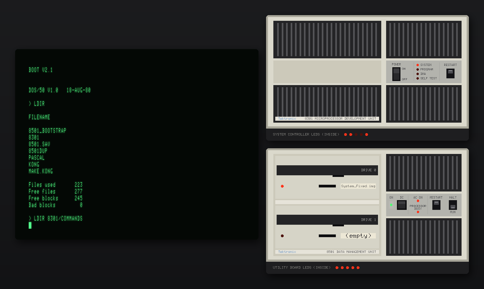
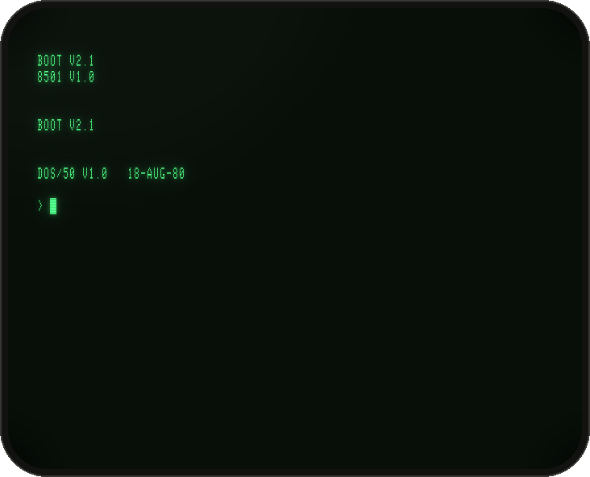
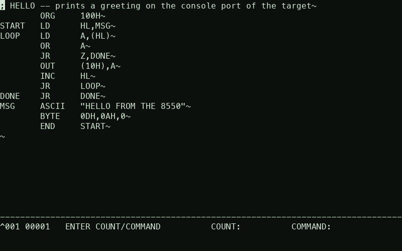
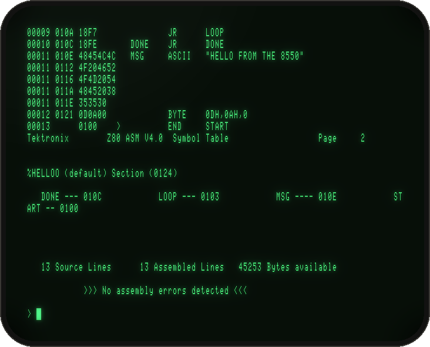
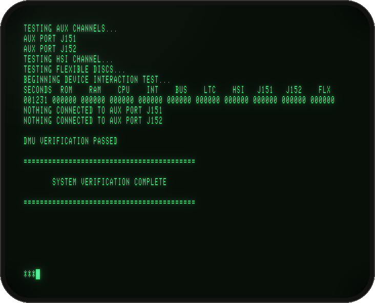

# Tektronix 8550 Microcomputer Development Lab — emulated

> *1980. A two-box development lab, a green-screen terminal, 8″ floppies and an in-circuit emulator.
> Tektronix built it so engineers could write, assemble and debug code for the microprocessors of the day.
> Almost none survive. This project brings one back, from the original ROMs and disks.*



The **Tektronix 8550 MDL** pairs an **8301 Microprocessor Development Unit** (a Signetics 2650 system processor, a Z80 language processor and a plug-in emulator board) with an **8501 Data Management Unit** (an LSI-11/2 file server with two Qume 8″ drives), driven from a **CT8500** terminal. This emulator runs all three, instruction by instruction, on the original firmware and **DOS/50 V1.0**:

- 🖥️ **The real lab, on your desk.** It boots `BOOT V2.1` → `DOS/50 V1.0 18-AUG-80` from the surviving disk images, runs Tektronix's editors (EDIT, ACE), Z80 assembler and linker, and debugs programs on the emulator board: `GO`, breakpoints, `TRACE`, `DS`.
- 💾 **Floppies the hard way.** The 8501's disc controller is emulated at chip level: its own Z80 runs the original controller ROM against modelled Qume drives. FORMAT, VERIFY and whole-disc COPY work as they did in 1980, including seek and rotation times.
- 🟢 **A terminal that glows.** An optional SDL3 window shows the CT8500's dot-matrix raster in green phosphor. You type straight into it. Beside it are the **8301 and 8501 front panels**, with live lamps, working RESTART buttons and drives you drop disc images onto.
- 🔬 **Factory-grade.** Tektronix's own diagnostic suites (Diagnostic System 2.4 and 3.0) end in `SYSTEM VERIFICATION COMPLETE`.
- 🔌 **Plugged into the world.**
  - **Emulation modes 1/2:** run code against a "prototype" over a socket. [FUSE](https://fuse-emulator.sourceforge.net/) can play a ZX Spectrum target.
  - **Host transfers:** DOS/50 COMM and HOST exchange files with a host program.
  - **Lab options:** the RTPA real-time analyser and the PROM programmer are fitted.
- 🧩 **Headless or graphical, macOS, Linux or Windows.** The core is dependency-free C++17. The GUI is a separate front end, and every run can be scripted (`-type`, `-snap`, `-cycles`).

## Quick start
```
cd emu && make                                    # C++17, no dependencies
cp ../disks/System_helpfix.img ../disks/work.img  # work on a copy
build/tek8550 -rw -0 ../disks/work.img            # your terminal becomes the CT8500; > prompt after ~27 s
```
To quit, press **Ctrl-]** then `q`.

**The graphical lab** needs SDL3 (`brew install sdl3`, `apt install libsdl3-dev`, or MSYS2 `pacman -S mingw-w64-x86_64-SDL3`):
```
make gui
build/tek8550-gui -rw -0 ../disks/work.img        # terminal + 8301/8501 panels, sized to fit your screen
```
**Windows:** build natively under MSYS2/MinGW (`make`, `make gui`), or cross-compile from macOS/Linux with `make CROSS=x86_64-w64-mingw32-` (see [Tutorial 5](docs/TUTORIALS.md#5-build-for-windows)).

## Learn it
| | |
|---|---|
| [**docs/TUTORIALS.md**](docs/TUTORIALS.md) | short recipes: first boot in the graphical lab, a Z80 program from scratch, formatting and duplicating discs, scripted runs, building for Windows |
| [docs/OPERATION.md](docs/OPERATION.md) | the long hands-on tour: DOS/50, editors, assembler, debugging, target systems, host link, RTPA, PROM programmer, diagnostics |
| [docs/ARCHITECTURE.md](docs/ARCHITECTURE.md) | how the 8550 works and how the emulator models it |
| [emu/README.md](emu/README.md) | every option, the CT8500 key map, GUI hotkeys |
| [notes/](notes/) | register-level hardware notes from reverse engineering: 8301, 8501, the floppy controller, RTPA, TTA, prototype and host links |
| [docs/screenshots/](docs/screenshots/) | an edit → assemble → link → run session, and the diagnostics |
| [PLAN.md](PLAN.md), [FEASIBILITY.md](FEASIBILITY.md) | project history and the original feasibility study |
| [CLAUDE.md](CLAUDE.md) | orientation for contributors and coding agents: layout, conventions, regression checks |

## Gallery
| | |
|---|---|
|  |  |
| DOS/50 V1.0 comes up from the original system disc | ACE, Tektronix's full-screen editor, through the emulated CT8500 |
|  |  |
| Z80 ASM V4.0B listing of a program written on the lab | Diagnostic System 3.0: verification complete |

## What's emulated
| Unit | Boards and status |
|---|---|
| **8301 MDU** | 2650 system controller and boot/diagnostic ROMs, system and program memory, DMA, Z80 Language Processor, Emulator Controller, **Z80** and **8085** emulator boards, memory map and write protection, REMOTE port, **RTPA**, **PROM programmer** (2708/2716/2732), TTA (in progress) |
| **8501 DMU** | LSI-11/2 with utility PROMs and LTC, HSI link to the 8301, **Flexible Disc Controller at chip level** (Z80 + ROM 160-0412-00), Qume DataTrak 8 drives in all four disc formats |
| **CT8500** | the terminal's command set and host-control mode (ACE works), drawn as text or as its dot raster |

**Not (yet) emulated:**
- the 6800, 8080 and 8086 emulator boards;
- most of the Trigger Trace Analyzer;
- 8085 target modes 1 and 2.

**Never dumped, so approximated:**
- the CT8500 character ROM: the screen uses a Tektronix 308 ROM upper case plus a matching hand-drawn lower case;
- the firmware of the Z80 and 8085 emulator boards: emulated at high level from reverse engineering.

## Repository layout
```
emu/         the emulator (C++17): cpu/ cores, machine/ boards, system/ the lab, host/ terminal and links,
             frontend/sdl/ the graphical front end, artwork/ front-panel layouts (MAME .lay)
tools/       helpers: IMD reader, reference target and host, screenshot/hero renderers, panel generator
notes/       hardware notes and ROM disassembly listings
docs/        tutorials, architecture, screenshots
roms/        ROM images (see roms/MANIFEST.md)
disks/       working disk images (DOS/50 with a repaired HELP file; rebuild with tools/make_system_helpfix.py)
sources/     original material: disk images, manual OCR text, photos (PDF scans and photos are not committed)
reference/   the MAME source files the CPU cores and devices were ported from
```

## Credits and licences
- **Author:** Hugo José Pinto (hugo.pinto@gmail.com).
- **Licence:** the emulator and tools are free software under the **GPL-2.0-or-later** ([LICENSE](LICENSE)): use them for anything, and if you distribute a derived work, publish its source under the same terms. Details, third-party licences and the status of the Tektronix material are in [NOTICE.md](NOTICE.md).
- **CPU cores and devices:** the 2650, LSI-11 and 8085 cores, the Am9513 and the disassemblers are ported from [MAME](https://www.mamedev.org/) (BSD-3-Clause; see `reference/mame/SOURCE.txt`). The Z80 core is [superzazu/z80](https://github.com/superzazu/z80) (MIT). Local changes are marked `[tek8550]`. The optional GUI uses [SDL3](https://www.libsdl.org/) (zlib).
- **Sources:** ROM dumps, disk images and manuals come from [bitsavers](https://bitsavers.org/pdf/tektronix/85xx/) and [TekWiki](https://w140.com/tekwiki/wiki/8550), and are © Tektronix. They are included for preservation and research. Front-panel artwork is drawn after period catalogue photos and photos of surviving units.
- **Upstreaming:** the machine code is structured as MAME devices so it can be offered to MAME, which accepts GPL-2.0-or-later contributions.
