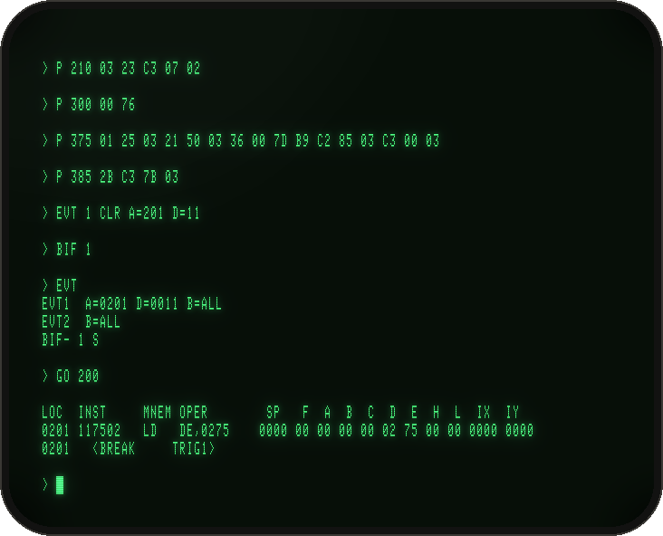
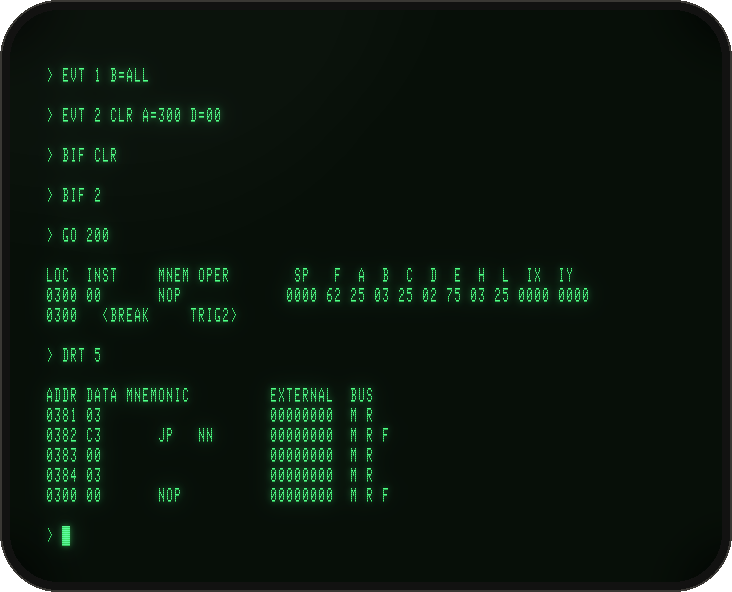
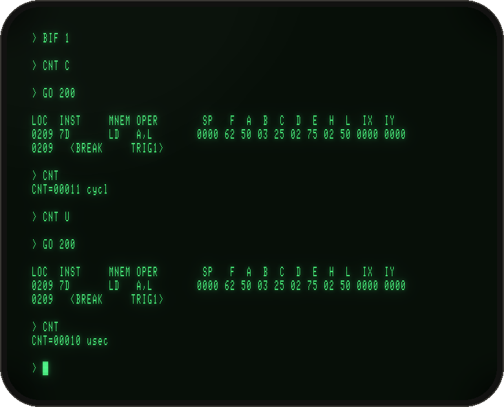
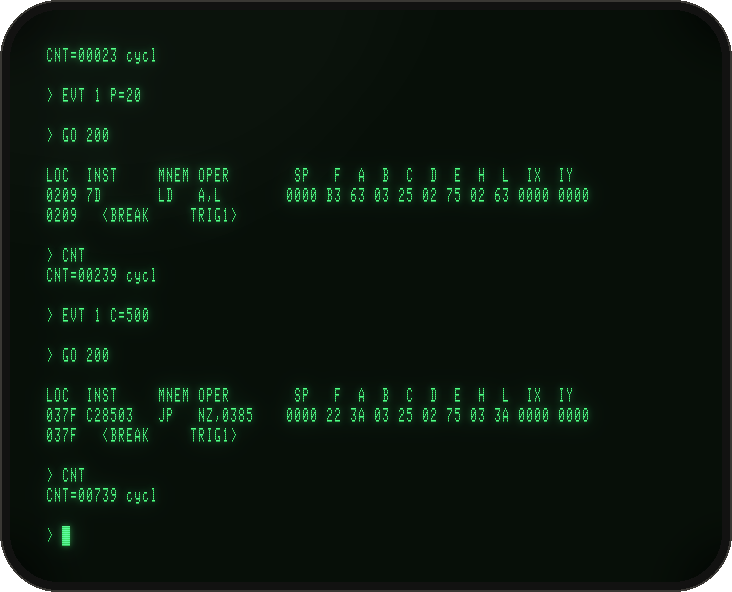
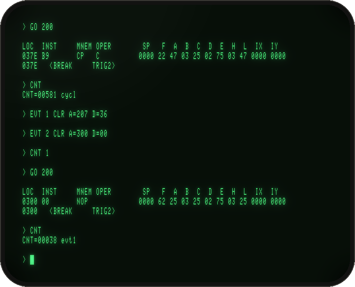
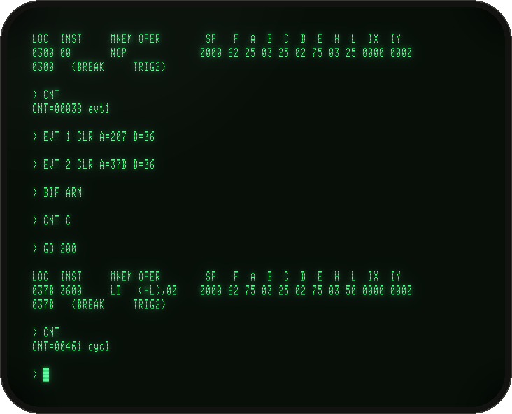
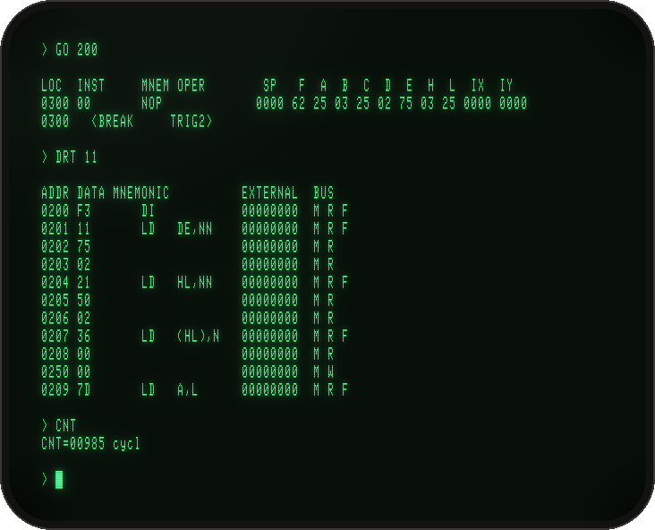
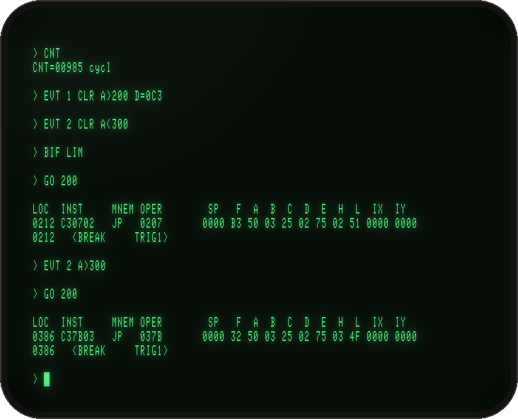

# Analysing programs with the Real-Time Prototype Analyzer

The **Real-Time Prototype Analyzer** (RTPA, option 8550F02) is one board in the 8301, wired to the bus of the emulator processor that runs your program. It watches every bus cycle at full speed, without slowing the program down. With it you can:

- **stop on an event**: an address (equal, at most, at least, or its low byte), a data value, a kind of bus cycle (fetch, memory read or write, I/O), a pattern on the probe's eight clips, or two events combined;
- **count** passes before stopping ("the 20th time"), or **delay** the stop by a number of bus cycles, fetches, clocks or microseconds;
- **measure** what happens between two events: fetches, bus cycles, processor clocks, microseconds, milliseconds;
- **record** the last 128 bus transactions, all of them or only fetches, reads, writes or I/O, and list them with the opcodes decoded.

DOS/50's own `BK` breakpoints stop on an address. The RTPA stops on conditions, and shows what led up to them. The later [Trigger Trace Analyzer](TTA.md) does much more, with four channels and 255 cycles.

No 8550 manual for the RTPA survives, but the board is the 8001/8002's, and Tektronix's **8002 RTPA users guide** (070-2785, 1979) does: its §3 is seven procedures on an 8080 sample program, with the displays a real 8002A printed. This tutorial runs the same program on the 8550's Z80 emulator. The 8080 bytes are valid Z80 code with the same bus cycles per instruction, and every bus-cycle count below is the one the guide printed on the 8002A. The sibling 8002 emulator checks the guide's displays one by one (`../tektronix-8002-emulator/tests/rtpa_guide.sh`); how the board works is in [notes/rtpa.md](../notes/rtpa.md).

**Contents:** [1. Start the lab](#1-start-the-lab) · [2. The sample program](#2-the-sample-program) · [3. Stop on an event](#3-stop-on-an-event) · [4. Look back: the trace](#4-look-back-the-trace) · [5. Count and time](#5-count-and-time) · [6. Pass counts and delays](#6-pass-counts-and-delays) · [7. Count loop passes](#7-count-loop-passes) · [8. Measure between two events: ARM](#8-measure-between-two-events-arm) · [9. Freeze the trace: FRZ](#9-freeze-the-trace-frz) · [10. Limits: LIM](#10-limits-lim) · [11. Before, around or after the event](#11-before-around-or-after-the-event) · [Command reference](#command-reference) · [In the emulator](#in-the-emulator)

## 1. Start the lab

Fit the RTPA with `-rtpa`, from `emu/`, on a copy of the system disc:
```
cp ../disks/System_Fixed.img /tmp/work.img
build/tek8550 -rtpa -0 /tmp/work.img        # or build/tek8550-gui -rtpa -0 /tmp/work.img
```
At the `>` prompt (after about 30 s), select the Z80 emulator:
```
> SEL Z80
```
Two things to know about DOS/50's number syntax: values are hexadecimal, and **a value that starts with a letter needs a leading 0** (`D=0B9`, not `D=B9`, which DOS/50 takes for a symbol: "Error 53 Symbol not found").

## 2. The sample program

The guide's program clears 0250–0275, then 0350 down to 0325, and halts:

| Address | Bytes | Z80 (8080) | |
|---|---|---|---|
| 0200 | F3 | DI | START |
| 0201 | 11 75 02 | LD DE,0275 (LXI D) | end of the first area |
| 0204 | 21 50 02 | LD HL,0250 (LXI H) | start of the first area |
| 0207 | 36 00 | LD (HL),0 (MVI M) | LOOP1: clear a byte |
| 0209 | 7D | LD A,L (MOV A,L) | |
| 020A | BB | CP E (CMP E) | reached 75? |
| 020B | C2 11 02 | JP NZ,0211 (JNZ) | no: go on |
| 020E | C3 75 03 | JP 0375 (JMP) | yes: the second area |
| 0211 | 23 | INC HL (INX H) | |
| 0212 | C3 07 02 | JP 0207 | |
| 0375 | 01 25 03 | LD BC,0325 | |
| 0378 | 21 50 03 | LD HL,0350 | |
| 037B | 36 00 | LD (HL),0 | LOOP2 |
| 037D | 7D | LD A,L | |
| 037E | B9 | CP C | reached 25? |
| 037F | C2 85 03 | JP NZ,0385 | |
| 0382 | C3 00 03 | JP 0300 | |
| 0385 | 2B | DEC HL | |
| 0386 | C3 7B 03 | JP 037B | |
| 0300 | 00 | NOP | the last RTPA breakpoint |
| 0301 | 76 | HALT | |

Fill the area with FF, so that the zeros show, and patch the program in:
```
> F 200 400 FF
> P 200 F3 11 75 02 21 50 02 36 00 7D BB C2 11 02 C3 75
> P 210 03 23 C3 07 02
> P 300 00 76
> P 375 01 25 03 21 50 03 36 00 7D B9 C2 85 03 C3 00 03
> P 385 2B C3 7B 03
```
Each pass of LOOP1 or LOOP2 is 6 instructions and **12 bus cycles**. LOOP1 runs 38 times, LOOP2 44 times.

## 3. Stop on an event

An **event** is a condition on one bus cycle. Event 1: address 0201, data 11 (the `LD DE` opcode). `BIF` ("break if") says which events stop the program:
```
> EVT 1 CLR A=201 D=11
> BIF 1
> EVT
EVT1  A=0201 D=0011 B=ALL
EVT2  B=ALL
BIF- 1 S
> GO 200
LOC  INST     MNEM OPER        SP   F  A  B  C  D  E  H  L  IX  IY
0201 117502   LD   DE,0275    0000 00 00 00 00 02 75 00 00 0000 0000
0201   <BREAK     TRIG1>
```


*`EVT` shows the setting; `GO 200` stops after `LD DE`, and `TRIG1` names the event.*

The program stopped **after** the instruction whose cycle matched: `LD DE` has run (DE = 0275). `TRIG1` says event 1 did it.

`B=` restricts the kind of bus cycle: `F` fetch, `MR`/`MW` memory read/write, `IR`/`IW` I/O, `W` any write, `ALL`. With `EVT 1 B=W` nothing matches, since nobody writes to 0201, and the program runs on to its halt:
```
> EVT 1 B=W
> GO 200
0301 76       HALT            0000 62 25 03 25 02 75 03 25 0000 0000
0301   <BREAK     HALT>
```
Event 2 works the same way. Break on the `NOP` at the end:
```
> EVT 1 B=ALL
> EVT 2 CLR A=300 D=00
> BIF CLR
> BIF 2
> GO 200
0300 00       NOP             0000 62 25 03 25 02 75 03 25 0000 0000
0300   <BREAK     TRIG2>
```

## 4. Look back: the trace

All the while, the RTPA recorded the bus transactions. `DRT n` lists the last n:
```
> DRT 5
ADDR DATA MNEMONIC          EXTERNAL  BUS
0381 03                     00000000  M R
0382 C3       JP   NN       00000000  M R F
0383 00                     00000000  M R
0384 03                     00000000  M R
0300 00       NOP           00000000  M R F
```


*Event 2 stops on the `NOP` at 0300; `DRT 5` shows the `JP 0300` that led there.*

The way into 0300: the `JP 0300` at 0382, its two address bytes, then the fetch at 0300. The bus column is **M**emory or **I**/O, **R**ead or **W**rite, **F**etch. EXTERNAL is the probe's eight clips.

`RTT` chooses what is stored. With only fetches, the same five lines reach further back:
```
> EVT 2 B=F
> RTT F
> GO 200
> DRT 5
037D 7D       LD   A,L      00000000  M R F
037E B9       CP   C        00000000  M R F
037F C2       JP   NZ,NN    00000000  M R F
0382 C3       JP   NN       00000000  M R F
0300 00       NOP           00000000  M R F
```
`RTT ALL` stores everything again.

## 5. Count and time

The **general-purpose counter** counts from the start of the run (`GO`) to the break. `CNT` chooses what it counts, and shows the result. Event 1 at the `LD A,L` in LOOP1:
```
> RTT ALL
> EVT CLR
> EVT 1 A=209 D=7D B=F
> BIF 1
> CNT C
> GO 200
0209 7D       LD   A,L        0000 62 50 03 25 02 75 02 50 0000 0000
0209   <BREAK     TRIG1>
> CNT
CNT=00011 cycl
> CNT U
> GO 200
> CNT
CNT=00010 usec
```


*From `GO` to the break at 0209: 11 bus cycles, 10 µs.*

**11 bus cycles**: DI (1), LD DE (3), LD HL (3), LD (HL) (3), and the fetch at 0209, as on the 8002A. The time is the 8550's: the guide's 8080 board took 17 µs.

The counter's units: `F` fetches, `C` bus cycles, `E` emulator clocks, `U` microseconds, `M` milliseconds, `T` trace stores, `1`/`2` occurrences of event 1/2.

## 6. Pass counts and delays

`P=n` waits for the n-th occurrence of the event:
```
> EVT 1 P=2
> CNT C
> GO 200
0209 7D       LD   A,L        0000 B3 51 03 25 02 75 02 51 0000 0000
0209   <BREAK     TRIG1>
> CNT
CNT=00023 cycl
> EVT 1 P=20
> GO 200
> CNT
CNT=00239 cycl
```
One pass of LOOP1 is 23 − 11 = **12 bus cycles**, so the 20th occurrence comes at 11 + 19 × 12 = **239**. L counts the passes.

`C=n` **delays** the break by n units of whatever `CNT` counts, here bus cycles:
```
> EVT 1 C=500
> GO 200
037F C28503   JP   NZ,0385    0000 22 3A 03 25 02 75 03 3A 0000 0000
037F   <BREAK     TRIG1>
> CNT
CNT=00739 cycl
```


*The 20th pass at 239 cycles; with `C=500` the break comes 500 cycles later, at 037F.*

239 + 500 = **739**, the guide's count and break address. The delay unit follows `CNT`: after `CNT U`, `C=20` means 20 µs.

Event 2 has its own pass count and delay. On the memory read of `CP C` in LOOP2:
```
> EVT 2 A=37E D=0B9 B=MR
> BIF CLR
> BIF 2
> GO 200
037E B9       CP   C          0000 32 50 03 25 02 75 03 50 0000 0000
037E   <BREAK     TRIG2>
> CNT
CNT=00473 cycl
> EVT 2 P=10
> GO 200
> CNT
CNT=00581 cycl
```
473 + 9 × 12 = **581**.

## 7. Count loop passes

`CNT 1` counts the occurrences of event 1. Put event 1 inside a loop and event 2 after it:
```
> EVT 1 CLR A=207 D=36
> EVT 2 CLR A=300 D=00
> CNT 1
> GO 200
0300 00       NOP             0000 62 25 03 25 02 75 03 25 0000 0000
0300   <BREAK     TRIG2>
> CNT
CNT=00038 evt1
```


*`CNT 1` counts event 1: LOOP1 ran 38 times before event 2 stopped the program.*

LOOP1 ran **38** times. An event counts even when it is not allowed to break: with `BIF` cleared (`EVT CLR` clears it too; `EVT` then shows `IND`), the program stops only at its halt, and `CNT 1` still counts.

## 8. Measure between two events: ARM

`BIF ARM` makes event 1 **arm** event 2: event 2 counts only after event 1 has happened, and the counter counts only while armed. That measures the time between two points of a program:
```
> EVT 1 CLR A=207 D=36
> EVT 2 CLR A=37B D=36
> BIF ARM
> CNT C
> GO 200
037B 3600     LD   (HL),00    0000 62 75 03 25 02 75 03 50 0000 0000
037B   <BREAK     TRIG2>
> CNT
CNT=00461 cycl
```


*461 bus cycles from LOOP1's first clear to LOOP2's.*

From the first clear of LOOP1 to the first of LOOP2: **461** bus cycles. With `EVT 1 P=10` the measurement starts at the 10th pass (**353**); with `EVT 2 P=20` too, it ends at LOOP2's 20th (**581**).

Two rules:
- **A delay on event 1 never runs out under ARM:** with `EVT 1 C=100` the program runs to its halt and the count stays 0 (the guide: "an EVT1 trigger cannot be generated"). A delay on event 2 works: `EVT 1 C=0`, `EVT 2 C=100` gives **681**.
- **Event 2 must come after event 1, not with it.** With both events on 0207, the break comes on the **next** pass, 12 cycles later:
```
> EVT 1 CLR A=207 D=36
> EVT 2 CLR A=207 D=36
> GO 200
0207 3600     LD   (HL),00    0000 B3 50 03 25 02 75 02 51 0000 0000
0207   <BREAK     TRIG2>
> CNT
CNT=00012 cycl
```

## 9. Freeze the trace: FRZ

`BIF FRZ` is ARM, plus: **the trace stops recording at event 1**. What led up to event 1 is kept, however long the program runs before event 2:
```
> EVT 1 CLR A=209 D=7D
> EVT 2 CLR A=300 D=00
> BIF FRZ
> CNT C
> GO 200
0300 00       NOP             0000 62 25 03 25 02 75 03 25 0000 0000
0300   <BREAK     TRIG2>
> DRT 11
ADDR DATA MNEMONIC          EXTERNAL  BUS
0200 F3       DI            00000000  M R F
0201 11       LD   DE,NN    00000000  M R F
0202 75                     00000000  M R
0203 02                     00000000  M R
0204 21       LD   HL,NN    00000000  M R F
0205 50                     00000000  M R
0206 02                     00000000  M R
0207 36       LD   (HL),N   00000000  M R F
0208 00                     00000000  M R
0250 00                     00000000  M W
0209 7D       LD   A,L      00000000  M R F
> CNT
CNT=00985 cycl
```


*The program ran on to 0300, but the trace ends at 0209, where event 1 froze it.*

The trace ends at 0209, event 1, though the program ran on for 985 cycles to 0300.

## 10. Limits: LIM

`BIF LIM` breaks when event 1 happens **within event 2's limits**. Event 2 lends only its address and bus type; its data, pass count and delay are ignored. Break on the first `JP` (data C3) above 0200 and below 0300:
```
> EVT 1 CLR A>200 D=0C3
> EVT 2 CLR A<300
> BIF LIM
> GO 200
0212 C30702   JP   0207       0000 B3 50 03 25 02 75 02 51 0000 0000
0212   <BREAK     TRIG1>
```
Move the window above 0300 (`EVT 2 A>300`), and the first `JP` there is LOOP2's:
```
0386 C37B03   JP   037B       0000 32 50 03 25 02 75 03 4F 0000 0000
0386   <BREAK     TRIG1>
```


*The first `JP` below 0300 is at 0212; with the window above 0300, LOOP2's at 0386.*

## 11. Before, around or after the event

The trace holds 128 transactions. Where the event falls in them depends on when you stop: break on the event and the trace shows what led to it; delay the break by 64 cycles and the event is in the middle; delay it by 128 and the trace shows what followed:
```
> EVT 1 CLR A=200 C=128
> BIF CLR
> BIF 1
> GO 200
0207 3600     LD   (HL),00    0000 A3 59 03 25 02 75 02 5A 0000 0000
0207   <BREAK     TRIG1>
```
`DRT *` lists all 128, starting just after the event at 0200 (`0202 75`, `0203 02`, `0204 21 LD HL,NN`...).

## Command reference

| Command | |
|---|---|
| `EVT n A=aaaa D=dd B=t T=bbbbbbbb P=n C=n` | set event n (1 or 2): address `A=` equal, `A<` at most, `A>` at least, `A:` low byte; data; bus type `F`, `MR`, `MW`, `IR`, `IW`, `R`, `W`, `ALL`; probe pattern (1, 0 or X per clip); pass count; delay |
| `EVT n CLR`, `EVT CLR`, `EVT` | clear an event; clear both and BIF; display |
| `BIF 1`, `2`, `IND`, `ARM`, `FRZ`, `LIM`, `CLR` | which events break. (TEKDOS on the 8002 adds a return option, `BIF IND C`, to print and continue; DOS/50 V1.0 does not have it) |
| `CNT x` | count `F` fetches, `C` bus cycles, `E` clocks, `U` µs, `M` ms, `T` trace stores, `1`/`2` events; also the unit of every delay. `CNT` alone shows the count |
| `RTT x` | store `ALL`, `F`, `MR`, `MW`, `IR`, `IW`, ... |
| `DRT n`, `DRT *` | list the last n, or all 128, stored transactions |

## In the emulator

- **Options:** `-rtpa` fits the board; `-rtpa probe` loops the probe back to A0–A7 (the diagnostic's fixture, RTPA.TST option 7). The probe cannot be fed from a target yet.
- **Its diagnostic:** `8550_DIAG.IMD`, Select mode 4 (`RTPA.TST`); options 0–7 pass, and system verification with `-rtpa` completes.
- **The pictures** are made by `tools/make_rtpa_shots.sh` from a scripted run of this session (the commands above, in order), so they come out the same on every run.
- **Trace of a run:** `TEK_RTPATRACE=1` logs every register access, match and break on stderr.
- **The same session on the 8002:** the sibling emulator follows the guide in TEKDOS, including the return option (`../tektronix-8002-emulator/docs/RTPA.md`).
