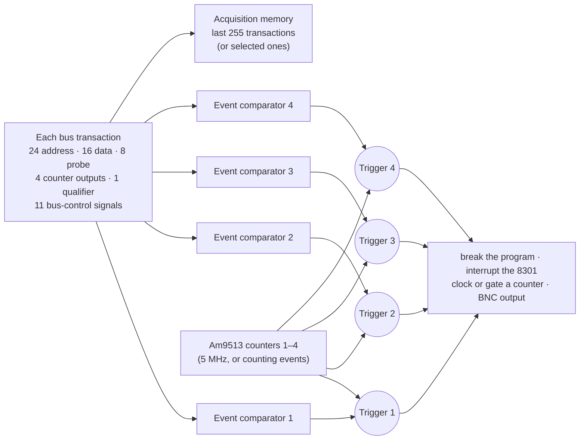
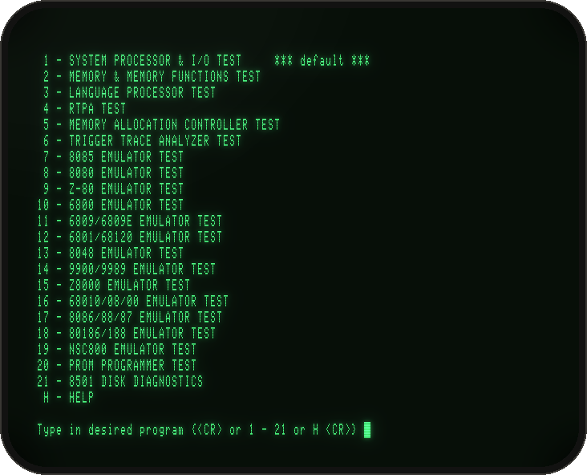
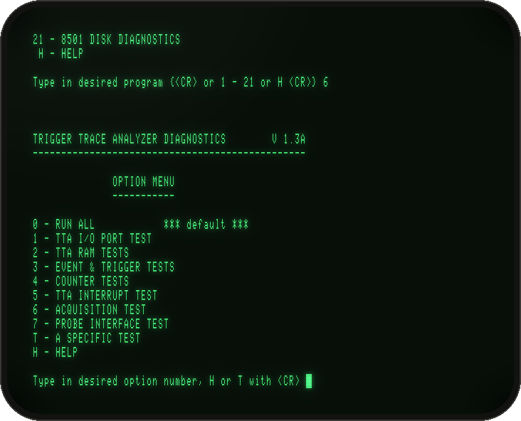
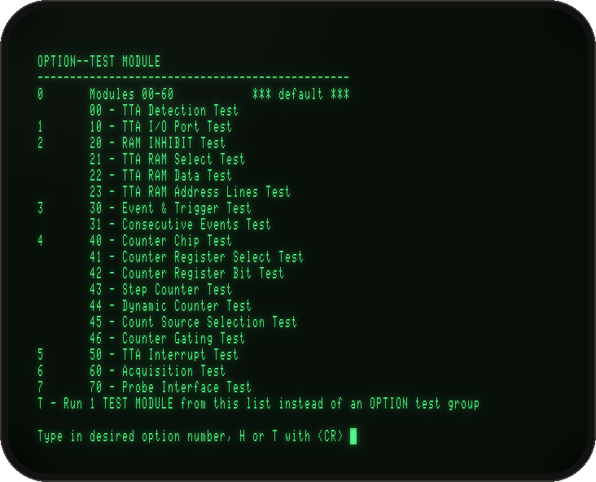
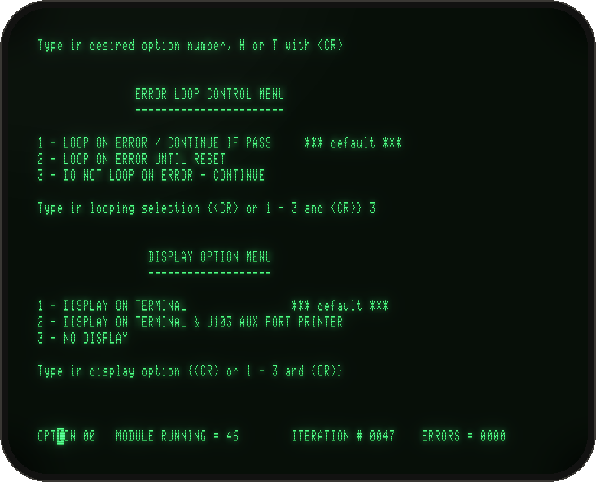
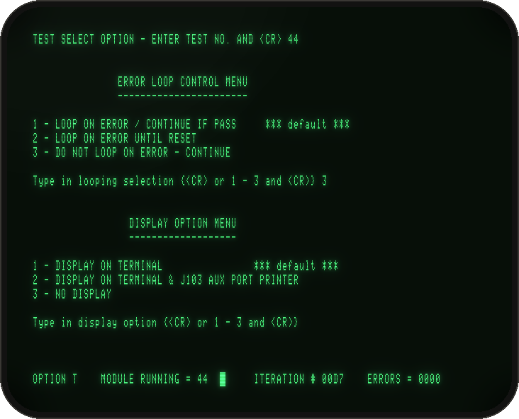
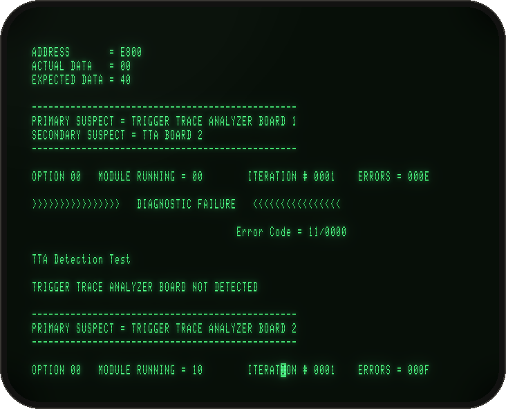
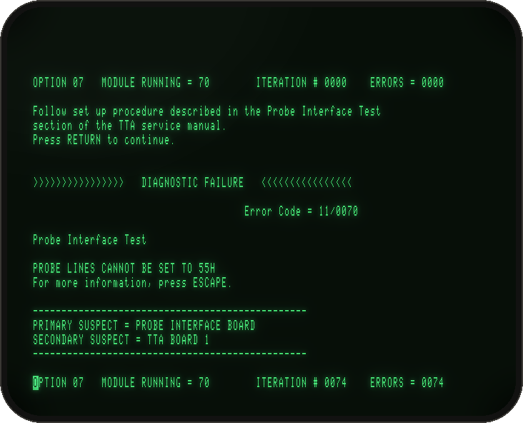
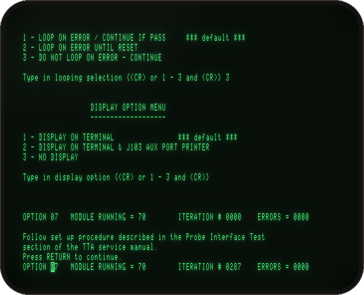

# The Trigger Trace Analyzer (TTA)

The TTA was the 8550's top-end debugging option (Tektronix 8550F03, 1982–83): two boards in the 8301 that watch every bus transaction of the program under test. It recognises up to four **events**, counts them, chains them, breaks the program or raises an interrupt when they happen, and records the last 255 transactions. It is the most intricate board in the lab.

This guide covers:
- what the TTA does;
- what the emulator can and cannot do with it;
- how to run its diagnostic, step by step, with pictures;
- how the board works at register level, for anyone who wants to drive it from 2650 code or continue the reverse engineering.

The facts, and how each was established, are in [notes/tta.md](../notes/tta.md).

**Contents:** [In one paragraph](#in-one-paragraph) · [What the TTA does](#what-the-tta-does) · [Fitting it](#fitting-it) · [Running the diagnostic](#running-the-diagnostic) · [Reading the results](#reading-the-results) · [How it works inside](#how-it-works-inside) · [A walk through module 30](#a-walk-through-module-30) · [Tracing](#tracing) · [What is not emulated](#what-is-not-emulated) · [Regenerating the pictures](#regenerating-the-pictures)

## In one paragraph

Start the lab with `-tta` and the board is there. No program you can run on this 8550 uses it: DOS/50 V1.0 (1980) predates the TTA, and the TTA commands (`ad`, `data`, `eve`, `cou`, `bre`, `acq`, `disp`…) belong to later DOS/50 versions and to the 8540's OS/40, which have not surfaced. What does exist is the board's own diagnostic, **TTA.TST V1.3A** on `8550_DIAG.IMD`, and it passes in full. TTA.TST drives the board in its **test mode**: the 8301's own 2650 processor plays the "program under test", and the diagnostic checks every part of the board against it. That is the mode the emulator implements, so you can watch the TTA's events, triggers, counters, interrupt and acquisition memory work, and program them yourself from 2650 code.

## What the TTA does

From the users manual (070-3760-01, §1):



- **Four trigger channels.** Each has an event comparator and a programmable counter, and its trigger is *event AND counter output*.
- **An event** is a pattern over the transaction: an address, data value, probe value or bus-control combination, or several ANDed. Address and data can be exact, carry don't-care digits (`ad 3 0X5XX`), or be ranges, including "not in range" (`ad -n 2 500 505`).
- **Triggers can arm each other:** trigger N arms trigger N+1, so the TTA can wait for "A, then B, then C".
- **Counters** (an AMD Am9513 with five 16-bit counters) can time, count events, or count only while an event condition holds.
- **Acquisition memory** keeps the last 255 transactions (address, data, probe, cycle type), or only selected ones.

## Fitting it

```
cd emu
build/tek8550 -tta -pm ext -0 ../sources/bitsavers/disks/8550_DIAG.IMD
```

| Option | Effect |
|---|---|
| `-tta` | Fits the TTA: ports 70–77 on the 8301, its RAM in the system-bus window E800–F9FF, the Am9513 |
| `-tta probe` | Also clips the P6451 acquisition probe onto the test points the diagnostic's probe test expects (an inferred fixture: see [the probe test](#the-probe-interface-test-option-7)) |
| `-pm ext` | The newer program-memory boards the 1983 diagnostics need (not the TTA itself) |
| `-ep none` | Optional: removes the Z80 emulator board, whose undumped firmware makes a full verification report 07/00D0 |

Without `-tta` nothing changes; the 8301 behaves exactly as before.

## Running the diagnostic

TTA.TST lives in the **Select** mode of Diagnostic System 3.0. Interactively, after the disc boots (about 30 s), answer the prompts as below. For batch runs, the same answers go in as `-type` timings (see the end of this section).

**1. Choose Select mode (2), then program 6, TRIGGER TRACE ANALYZER TEST.**



**2. TTA.TST's option menu.** Option 0 runs everything except the probe test; 1–7 run one group; `T` runs one module; `H` lists the modules.



**3. The module list** (`H`). Each test module has a two-digit number: the tens digit is its group.



| Module | Test | What it proves on the board |
|---|---|---|
| 00 | TTA Detection | Port 70 reads with bits 7–6 high: the board is fitted |
| 10 | I/O Port | Ports 70–74 hold a walking bit (73 holds four bits) |
| 20–23 | RAM inhibit, select, data, address lines | The TTA RAM appears in the window when selected, inhibits system RAM there, and every bit and address line works; page F5 is absent |
| 30 | Event & Trigger | Each event fires on its own, and triggers need the counter outputs |
| 31 | Consecutive Events | "Trigger N arms N+1", for every starting trigger |
| 40–43 | Counter chip, register select, register bits, step | The Am9513 is there and its registers work |
| 44 | Dynamic Counter | The counter clock is 5 MHz: the count over a timed 2650 loop must be exact to ±1 |
| 45 | Count Source Selection | Each event drives the right counter input (SRC1–4, GATE2–5), and F2–F5 divide correctly |
| 46 | Counter Gating | Counting only while an event condition holds, for each Am9513 gating mode |
| 50 | TTA Interrupt | A trigger interrupts the 8301 only when enabled, and only once |
| 60 | Acquisition | Transactions are stored and the pointer advances, for "selected" and "all" |
| 70 | Probe Interface | The eight probe lines reach the event comparators (option 7 only, needs a set-up) |

**4. Run option 0.** The next two menus are the same for every option:
- **Error loop control:** `3` = do not loop on error, just continue.
- **Display:** `RETURN` = on the terminal. `2` also prints on a printer at the 8301's J103 AUX port: with `-aux8301 file:log.txt` the whole report lands in that file.

TTA.TST then loops over modules 00–60 forever, updating the status line at the bottom (iteration and error counts are hex). Here it is in its 72nd pass (iteration 0047):



**5. One module.** Option `T`, then the module number, runs that module over and over. Here is module 44, the clock-exact counter test, at iteration 00D7 (215 passes):



**Batch.** The same session with no terminal, as the regression check runs it:

```
build/tek8550 -tta -ep none -pm ext -term tty -0 ../sources/bitsavers/disks/8550_DIAG.IMD \
    -cycles $((200*2000000)) -type 31 '2\r' -type 41 '6\r' -type 51 '\r' -type 56 '3\r' -type 61 '\r' -type 66 '\r'
```

`-type T TEXT` types at emulated second T, and `-cycles` sets the run's length (2,000,000 per emulated second). Batch runs go at about 100× real time, so 200 emulated seconds (about 30 passes) take a few seconds. Use `-snap T FILE` to save the screen, or grep the output for `Error Code`.

## Reading the results

The status line reads `OPTION nn  MODULE RUNNING = mm  ITERATION # iiii  ERRORS = eeee`, with the iteration and error counts in hex. On a failure, TTA.TST prints a report:
- `DIAGNOSTIC FAILURE` and an error code `11/00mm`, where 11 is the TTA and mm the module;
- what it read against what it expected;
- the suspect board.

The same diagnostic **without `-tta`**: every module fails, starting with the detection test.



Typical reports, and what they mean in board terms:

| Report | Meaning |
|---|---|
| `TRIGGERS ARE INCORRECT BECAUSE COUNTER OUTPUTS ARE STUCK` | The Am9513's status did not read FF with its outputs at high impedance, so the triggers (event AND counter output) cannot be judged |
| `EVENTS/TRIGGERS 4321  ACTUAL xxxx  EXPECTED xxxx` | The trigger latches (port 73) after a test transaction, bit by bit |
| `CTR REGISTER CONTENTS / EXPECTED`, with `COUNT SOURCE` or `GATE SIGNAL` | A counter's hold register after a timed or event-driven count |
| `TTA INTERRUPT DID NOT OCCUR` / `OCCURRED WHEN NOT EXPECTED`, with trap and enable bits | Module 50, with the trigger latches and interrupt enables at the time |
| `ACQ PTR IS xx; SHOULD BE yy`, with `ADDRESS / ACTUAL / EXPECTED DATA` | Module 60: the acquisition pointer or a stored sample is wrong |

### The probe interface test (option 7)

Option 7 asks for a set-up: "Follow set up procedure described in the Probe Interface Test section of the TTA service manual". That section is not in the service manual we have (070-3761-00). With nothing clipped onto the probe, the test fails, as the real board would:



What the test does is readable from its code:
- It writes **AA**, then **55**, to the Emulator Controller's port F4. That port drives the extended address lines A23–A16 and is written active low.
- After each write it expects the events that page 73 of the comparator RAM assigns to probe values 55 and AA respectively.
- So the fixture evidently clips the probe leads onto the extended address lines.

`-tta probe` models exactly that, and the test then passes:



The polarity is the one inference: the probe could equally see F4 uninverted, with the event bits reversed. Both explain the test. If the set-up procedure turns up, it will settle this.

## How it works inside

This is the board as the emulator models it, everything as TTA.TST established it. Addresses are as the 2650 sees them, through the diagnostic's bank window (port EE = 07: CPU 4000–7FFF = system bus C000–FFFF).

### Ports

| Port | R/W | Function |
|---|---|---|
| **70** | R/W | Control. **Bit 0:** comparators on (writing 0 clears the event latches). **Bit 1:** RAM select. **Bit 2:** counter clock on, and the comparator RAMs addressed by the 2650 (test mode); writing 0 clears the arming chain. Reads back with bits 7–6 high (board present). `07` = test mode, `03` = comparators on the probe, `02` = RAM access only |
| **71** | R/W | **Bits 7–4:** trigger 4–1 must be armed by the previous trigger (1 is armed by 4). **Bit 1:** acquire every access (otherwise only those on which event 4 fires) |
| **72** | R/W | Interrupt enables, one per trigger (bits 3–0). A write clears a pending TTA interrupt request |
| **73** | R/W | Trigger latches (bits 3–0), set by triggers. The 2650 writes it too (write 0 to clear) |
| **74** | R/W | 8-bit register, role unknown (the diagnostic only checks it holds data) |
| **75** | R | Acquisition pointer: where the next sample goes |
| **76 / 77** | R/W | Am9513: data / command and status |

### Memory

With port 70 bit 1 set and EE = 07, the TTA RAM answers at system bus E800–F9FF (CPU 6800–79FF) and system RAM there is switched off. It is organised as 256-byte pages:

| CPU page | Contents |
|---|---|
| 68–6F | **Acquisition memory:** 256 samples × 8 bytes, one page per byte. In test mode each byte of a sample is the 2650's A7–0; on the probe, page 6A is the probe byte |
| 70–74, 76–79 | **Comparator lookup RAMs**, one per input group, addressed by that group's value (or by the 2650's A7–0 in test mode). Each holds, per row, the events that value takes part in |
| 75 | Absent: no RAM, and system RAM is still inhibited (module 20 checks this) |

### Events and triggers

At each 2650 access to a comparator page, with port 70 bits 1–0 set, the board looks up one row in every comparator RAM and latches four events. The row is the 2650's A7–0 in test mode; page 73 uses the probe lines instead when port 70 bit 2 is clear.

- **Event k** fires when **page 73's bit 3+k is set** (high nibble, one bit per event) **and page 74's bit pair for event k is 00**. Page 74 holds two bits per event (bits 1–0 for event 1, … 7–6 for event 4). That fits the relation codes a range comparator needs, though in the tests only 00 = "match" appears.
- Event outputs are **levels**, held until the next comparator access. They hold while port 70 bit 0 stays set, even with the clock stopped.
- **Trigger k** = event k AND counter k's output. With port 71 bit 3+k set, trigger k also needs trigger k−1 to have fired on an earlier access. Triggers set the latches in port 73.

### Counters

- The Am9513 runs from **X1 = 5 MHz** while port 70 bit 2 is set. It comes from the 8301's 20 MHz oscillator, which also gives the 2650 its 2 MHz, so there are exactly 2.5 counter clocks per 2650 clock.
- **Event k drives SRC k and GATE k+1.** So a counter can count event k (count source SRC k), or count F1 only while event k−1 holds (gating "GATE N", active high or low), and so on. SRC5 and GATE1 are not driven by events.
- **Counter outputs OUT1–4 feed the triggers.** An output set to high impedance (output control 100) reads high: that is how a channel's trigger is made to follow its event alone. The status register's bits 7–6 read 1.

### Interrupt

- A **new** trigger whose port 72 bit is set raises 2650 interrupt **29** (vector 3A), the one the RTPA also uses. Triggers already latched when the enables are written do not, nor do bits the 2650 writes into port 73.
- The request shows in Emulator Controller port F2 bit 2 (read active low) until port 72 is written again.

### Acquisition

- At each comparator access, if port 71 bit 1 is set, or else if event 4 fires, a sample is stored at the pointer, and the pointer (port 75) advances by one, wrapping at 256.

### A recipe: one event, counted

These steps are put together from what TTA.TST does in modules 30 and 45. They have not been run as a separate program:
1. **Select the RAM:** EE ← 07, port 70 ← 02.
2. **Clear pages 70–79**, then set up the row you will use, say 10:
   - page 73 row 10 = F0 (all events may fire);
   - page 74 row 10 = 54 (event 1's pair 00, the others 01).
3. **Program the counters.**
   - Am9513 reset: 77 ← FF, then 77 ← 5F (load all).
   - Counter 1 mode = 0108 (count source SRC1, count up): 77 ← 01 (data pointer: counter 1's mode), 76 ← 08 (low byte first), 76 ← 01.
   - Arm counter 1: 77 ← 21.
4. **Start:** port 70 ← 07 (comparators on, test mode, clock running).
5. **Fire event 1:** each write to page 7x row 10, for example 2650 address 7810, is one event 1. Its rising edge on SRC1 is one count. Port 73 bit 0 (trigger 1) is not set, though: in this mode counter 1's output is low. For triggers that follow the event, give counter 1 a high-impedance output (mode low byte 0C, as module 30 does).
6. **Read the count:** 77 ← 9F (disarm and save all), 77 ← 19 (counter 1's hold register), then read 76 twice, low byte first.

## A walk through module 30

`TEK_TTATRACE=1` logs every port access, event change and acquisition, with the time in emulated seconds, exact to the 2650 clock. Here is one pass of module 30, the event & trigger test, annotated:

```
[66.0878720 TTA wr 77 01]       counter 1 mode register...
[66.0878765 TTA wr 76 0c]       ...= 0B0C: count F1 up, output high impedance
[66.0878810 TTA wr 76 0b]
[66.0879110 TTA rd 77 ff]       status FF: all counter outputs high, so triggers = events
[66.0879380 TTA wr 70 02]       RAM select: initialise the comparator pages (31D3)
[66.1202150 TTA wr 70 07]       test mode
[66.1202285 TTA wr 73 00]       clear the trigger latches
[66.1202375 TTA events 1]       the 2650 writes page 78 row 10: event 1 fires
[66.1202420 TTA rd 73 01]       trigger 1 latched: expected 0001
[66.1202705 TTA wr 73 00]
[66.1202795 TTA events 2]       row 20: event 2
[66.1202840 TTA rd 73 02]
[66.1203125 TTA wr 73 00]
[66.1203215 TTA events 4]       row 30: event 3
[66.1203260 TTA rd 73 04]
[66.1203545 TTA wr 73 00]
[66.1203635 TTA events 8]       row 40: event 4...
[66.1203635 TTA acquire 40 at 00]  ...which also takes an acquisition sample
[66.1203680 TTA rd 73 08]
[66.1204085 TTA wr 70 00]       comparators off: event latches cleared
[66.1204385 TTA wr 77 ff]       counter reset: outputs now low
[66.1204835 TTA rd 77 c1]       status C1: outputs low
[66.1204985 TTA wr 70 07]
[66.1205075 TTA events f]       row 0: all four events fire...
[66.1205150 TTA rd 73 00]       ...but no triggers: the counter outputs are low
```

## Tracing

| Variable | What it logs |
|---|---|
| `TEK_TTATRACE=1` | TTA ports, event changes and acquisitions (stderr) |
| `TEK_INTTRACE=1` | interrupts the 2650 takes (`INT 29` is the TTA's or the RTPA's) |

To study a module, run it alone (`-type 51 'T\r' -type 56 '46\r'`) with the trace on, and dump TTA.TST from memory to read its code:

```
build/tek8550 -tta -ep none -pm ext -term tty -0 ../sources/bitsavers/disks/8550_DIAG.IMD \
    -cycles $((45*2000000)) -type 31 '2\r' -type 41 '6\r' -dump /tmp/tt </dev/null
build/dasm s2650 /tmp/tt.8301 0 2000 2000 | less
```

The modules' entry points are listed in [notes/tta.md](../notes/tta.md).

## What is not emulated

- **Run mode:** watching a real target program. In real use the comparator RAMs are addressed by the target's bus (address bytes, data bytes, probe, control signals), one group per page. Which group feeds which page, and how page 74's 2-bit codes combine into ranges, cannot be learned from the diagnostic: it only uses test mode. Software that programs the TTA (a later DOS/50 or OS/40 with its `ad`/`data`/`eve` commands) would settle it. Until then the TTA watches only the 2650's own accesses to it.
- **Counter inputs not driven by events:** SRC5, GATE1 and F1-as-source (TTA.TST skips them), the event-qualifier BNC input and the trigger BNC outputs.
- **The probe fixture's polarity** (above).

## Regenerating the pictures

```
tools/make_tta_shots.sh [WORKDIR]
```

It renders `docs/screenshots/tta/*.png` from batch runs. They are deterministic, so the pictures come out the same every time.
