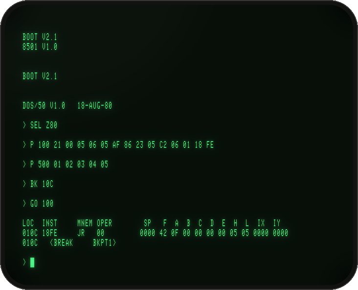
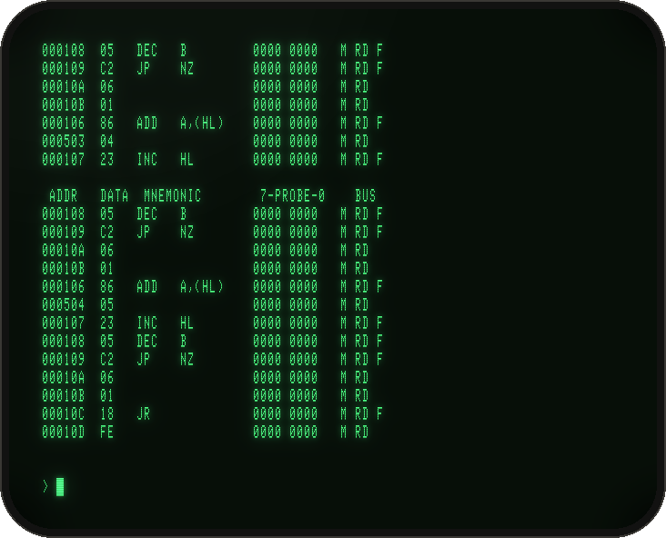
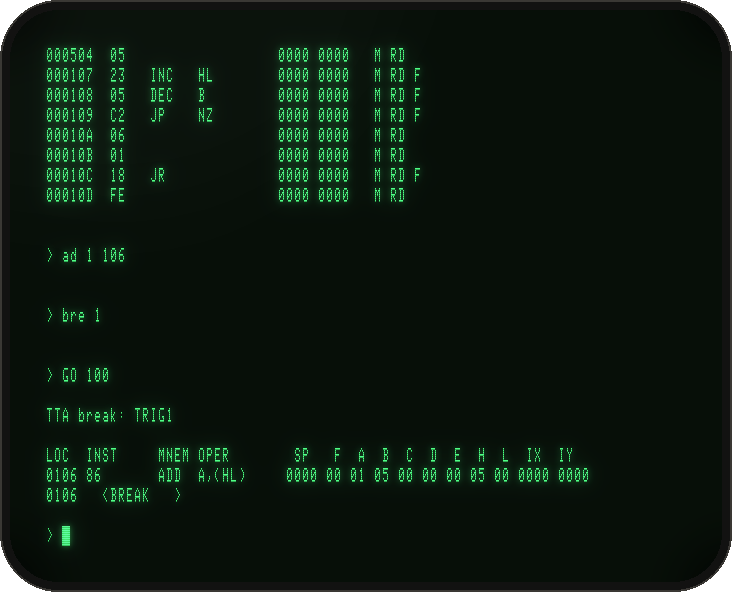
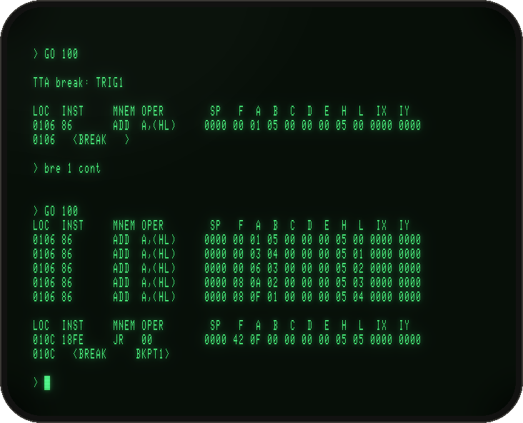
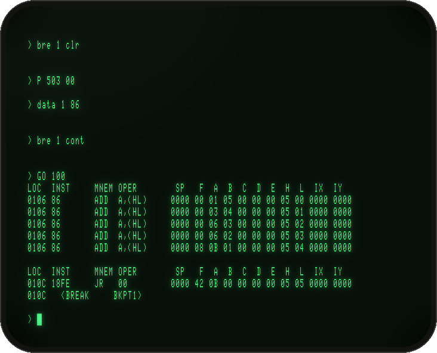
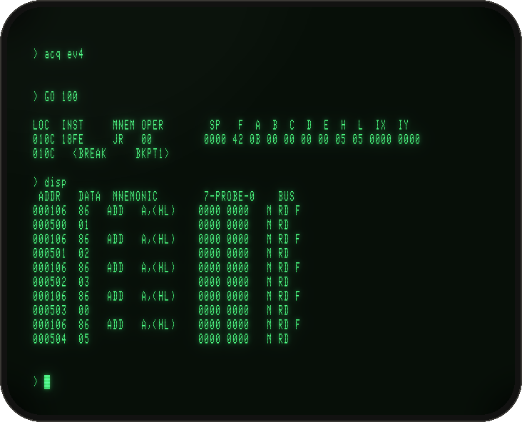
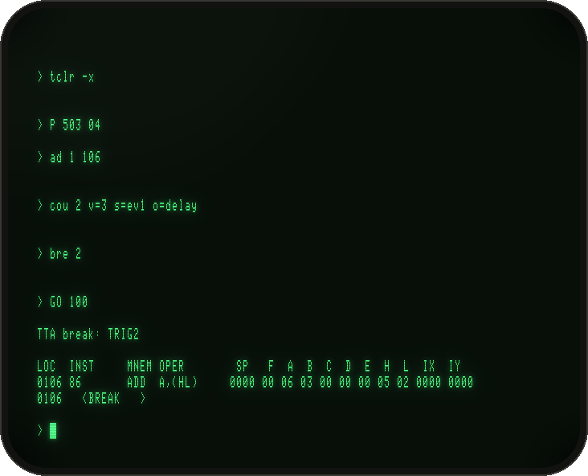
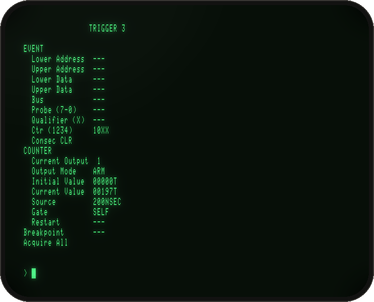

# Analysing programs with the Trigger Trace Analyzer

The **Trigger Trace Analyzer** (TTA, option 8550F03, 1982) was the most powerful debugging tool you could put in an 8550. It is two boards in the 8301, wired to the bus of the emulator processor that runs your program. They watch every bus cycle of that processor at full speed. With them you can:

- **stop the program** on an exact condition: an address, a range of addresses, a data value, a kind of bus cycle, or several of these at once;
- **watch without stopping**: print the processor's state each time the condition happens, and let the program run on;
- **record** the last 255 bus cycles, or only the ones you care about, and list them afterwards with the opcodes decoded;
- **count** events, passes, cycles or time, with four hardware counters, and use the counts to decide when to stop ("on the third pass") or to measure how long code takes;
- **chain conditions**: "a write to the last stack byte *immediately followed by* a write past the stack".

The TTA does all this without touching your program or slowing it down. DOS/50's own `BK` breakpoints can only stop on an address. The older RTPA option has two simple events and a 128-cycle trace.

This tutorial follows the **learning guide of the TTA users manual** (Tektronix 070-3760-01, §1), with its own sample program, then goes further into counting and timing. Each step shows what you type and what the lab answers.

**Contents:** [How it fits together](#how-it-fits-together) · [1. Start the lab](#1-start-the-lab) · [2. The sample program](#2-the-sample-program) · [3. What the TTA recorded](#3-what-the-tta-recorded) · [4. Stop on an event](#4-stop-on-an-event) · [5. Watch without stopping](#5-watch-without-stopping) · [6. Hunt a bug](#6-hunt-a-bug) · [7. Record only what matters](#7-record-only-what-matters) · [8. Stop on the third pass](#8-stop-on-the-third-pass) · [9. Time a piece of code](#9-time-a-piece-of-code) · [Command reference](#command-reference) · [In the emulator](#in-the-emulator)

## How it fits together

You type TTA commands at the DOS/50 prompt, mixed with ordinary DOS/50 commands: `P` to patch memory, `GO` to run, and so on. A TTA set-up has four **trigger channels**, numbered 1 to 4. Each channel has three parts:

| Part | Set with | What it is |
|---|---|---|
| **Event** | `ad`, `data`, `bus`, `pro`, `ctr`, `qua`, or `eve` for all of them at once | A condition on one bus cycle: address, data, cycle type, probe lines, counter outputs, external qualifier. Parts you leave undefined are "don't care", so an empty event matches every cycle |
| **Counter** | `cou` | A 16-bit counter. Its output is ANDed with the event, so it can hold the trigger back until "the third time", or until some time has passed. Unprogrammed, its output stays high and the trigger simply follows the event |
| **Action** | `bre` | What the trigger does: **stop** the program, or **cont**inue and print a trace line |

**Trigger N = event N AND counter N's output.** On top of the channels:
- `cons` links events into sequences on consecutive cycles;
- `acq` chooses what goes into the acquisition memory, and `disp` lists it;
- `ts` shows the whole set-up, and `tclr` clears it.

## 1. Start the lab

Fit the TTA with `-tta`, from `emu/`, on a copy of the system disc:
```
cp ../disks/System_Fixed.img /tmp/work.img
build/tek8550-gui -tta -0 /tmp/work.img        # or build/tek8550 -tta -0 /tmp/work.img
```
When the `>` prompt appears (after about 30 s), select the Z80 emulator:
```
> SEL Z80
```
The TTA works with the emulator processor board, the Z80 by default. The commands below can be typed in upper or lower case.

## 2. The sample program

The manual's program adds the five numbers 1 to 5 from a table at 0500 and leaves the sum in the accumulator. It was written for the 8085, but its bytes are equally valid Z80 code, so we use it as printed. The only change is the ending: the manual exits through a service call, while we let the program loop at its end and put a DOS/50 breakpoint there.

| Address | Bytes | Z80 | Explanation |
|---|---|---|---|
| 0100 | 21 00 05 | LD HL,0500 | Set table pointer |
| 0103 | 06 05 | LD B,5 | Set pass counter |
| 0105 | AF | XOR A | Clear accumulator |
| 0106 | 86 | ADD A,(HL) | Add byte from table |
| 0107 | 23 | INC HL | Point to next byte |
| 0108 | 05 | DEC B | Decrement pass counter |
| 0109 | C2 06 01 | JP NZ,0106 | Loop if not fifth pass |
| 010C | 18 FE | JR 010C | Done: wait here |

Patch it in, set the breakpoint and run it:
```
> P 100 21 00 05 06 05 AF 86 23 05 C2 06 01 18 FE
> P 500 01 02 03 04 05
> BK 10C
> GO 100
```



The trace line shows **A = 0F** (15 = 1+2+3+4+5): the program works. `<BREAK BKPT1>` is DOS/50's own breakpoint at 010C.

## 3. What the TTA recorded

The TTA was recording while the program ran. By default it keeps the last 255 bus cycles. List them:
```
> disp
```



Each line is one bus cycle:
- **ADDR** and **DATA**: what was on the bus.
- **MNEMONIC**: the opcode, decoded, on instruction fetches.
- **7-PROBE-0**: the eight lines of the data acquisition probe (nothing is clipped on here).
- **BUS**: the cycle type: `M RD F` is a memory read that fetches an opcode, `M RD` a plain memory read, `M WT` a write, `I RD`/`I WT` I/O.

You can follow the program cycle by cycle: each pass fetches `ADD A,(HL)` at 0106, then reads the table byte at 0500, 0501, …

The run is 43 cycles (6 to set up, 7 per pass, 2 for the final JR), so its start has scrolled off the screen; `disp 20` shows only the last 20. `disp all` shows everything still in memory, with a dotted line between runs.

## 4. Stop on an event

Define **event 1** as any access to address 0106, and tell trigger channel 1 to **stop** the program:
```
> ad 1 106
> bre 1
> GO 100
```



The program stops after the instruction at 0106, the first `ADD`, so A = 01. The TTA names the channel that stopped it (**TTA break: TRIG1**), then DOS/50 prints the processor's state.

## 5. Watch without stopping

`bre 1 cont` makes channel 1 print a trace line each time it triggers, and lets the program run on:
```
> bre 1 cont
> GO 100
```



Five lines, one per `ADD`, show the accumulator growing: 01, 03, 06, 0A, 0F. The program still ends at the DOS/50 breakpoint. This is how you monitor a running program without single-stepping it.

Clear channel 1 before going on:
```
> ad 1 clr
> bre 1 clr
```

## 6. Hunt a bug

Now break the program: change the fourth number in the table from 04 to 00.
```
> P 503 00
```
Run it and the sum comes out as 0B instead of 0F. Pretend the program is a subroutine buried in something big, and that reading the listing doesn't explain the wrong answer. Rather than trace every instruction, ask the TTA to report each `ADD A,(HL)`. Its opcode is 86, so define event 1 as **data 86** and use continue mode:
```
> data 1 86
> bre 1 cont
> GO 100
```



The `ADD` ran five times, as it should, but A did not change after the fourth (06 → 06). So the fourth table entry is suspect.

## 7. Record only what matters

Recording everything makes a long listing. Better to record **only the bytes the ADD reads**. These are the memory reads that come straight after an `ADD` opcode fetch:
```
> data 1 clr
> bre 1 clr
> data 3 86            event 3: the ADD opcode (data 86)
> bus 4 m rd           event 4: any memory read
> cons cyc 34          event 4 counts only on the cycle right after event 3
> acq ev4              store only event 4's cycles
> GO 100
> disp
```



`cons cyc 34` links the events. Event 4 only fires when event 3 happened on the **immediately preceding** cycle. So among all memory reads, only the operand of an `ADD` qualifies. `acq ev4` stores just those, each with the `ADD` fetch that qualified it. The listing is ten lines, and it points straight at **0503 = 00**. You could now fix it with `P 503 04`.

## 8. Stop on the third pass

The counters make conditions like "the third time" possible. Here channel 2 stops the program on the third execution of the `ADD`:
```
> tclr -x                  clear the whole TTA set-up
> P 503 04                 (repair the table)
> ad 1 106                 event 1: the ADD at 0106
> cou 2 v=3 s=ev1 o=delay  counter 2: count event 1 down from 3; its output goes high when done
> bre 2                    trigger 2 stops the program
> GO 100
```



Event 2 is undefined, so it matches every cycle. Trigger 2 is therefore just counter 2's output. With `o=delay` that output stays low while counting and goes high when the count completes, on the third event 1. The program stops with A = 06 (1+2+3).

The output modes (`o=`) decide how a counter gates its trigger:

| `o=` | Counts | Output while counting | At the end | After |
|---|---|---|---|---|
| `arm` | up | 1 | 1 | 1 |
| `disarm` | up | 0 | 0 | 0 |
| `pulse` | down | 0 | 1 | 0 |
| `delay` | down | 0 | 0 | 1 |
| `timeout` | down | 1 | 1 | 0 |

So `delay` means "only after N", and `timeout` means "only during the first N". `pulse` fires once, exactly at the Nth.

## 9. Time a piece of code

The counters can also count time, with five timebases: `200nsec`, `2usec`, `20usec`, `200usec`, `2msec`. The manual's recipe measures the time from one address to another, here from the program's start at 0100 to its end at 010C:
```
> tclr -x
> eve 1 a=100 b=f              event 1: the fetch at 0100 (start)
> cou 1 s=ev1 o=delay v=1      counter 1's output goes high from the start onwards
> eve 2 a=10C b=f              event 2: the fetch at 010C (end)
> cou 2 s=ev2 o=delay v=1      counter 2's output goes high from the end onwards
> eve 3 c=10xx                 event 3: counter 1 high and counter 2 low, i.e. between start and end
> cou 3 g=self o=arm v=0 s=200nsec   counter 3 counts 200 ns ticks while trigger 3 holds
> GO 100
> ts 3
```



Counter 3 holds **197**: 197 × 200 ns = 39.4 µs. To check by hand, the Z80 at 4 MHz needs 10 + 7 + 4 T-states to set up, then 5 × 27 for the loop: 156 T-states = 39.0 µs. The timer is right to within its 200 ns tick. Change `s=` to `2usec` for longer code; `ts` shows any counter's value at any time.

`ts` on its own shows the complete set-up of all four channels, as in the manual's Display 2-1.

## Other processors and target systems

**The 8085 board.** The TTA watches the 8085 emulator board as well (`-ep 8085`, with DOS/50's 8085 support installed once from the 8085 disc, see `emu/README.md`). There, everything looks exactly as in the manual, which was written for the 8085:
- `disp` decodes `LXI H`, `ADD M`, `JNZ`…;
- an `OUT F7` is acquired as `00F7F7 0F I WT`;
- the trace line has the 8085's columns (`IM`, `SOD`).

The sample program needs the same ending as on the Z80: patch `C3 0C 01` (JMP 010C) at 010C and set `BK 10C`.

**Target systems (emulation modes 1 and 2).** The TTA sits on the emulator processor's bus, so it sees the program's cycles whatever they reach: program memory, or a target system over the prototype link (`-target`, [INTEGRATION.md](INTEGRATION.md)). In mode 1, with the program in program memory and its I/O on the target, an `OUT (10H),A` to the target is caught and recorded as `I WT`. In mode 2, with program and data in the target's RAM, the operand-only recording of section 7 comes out the same. Mode 2 is slow (one socket round trip per access), but the TTA adds nothing to that.

**The probe.** The real TTA's eight probe leads (and its EVENT QUALIFIER input) clip onto any signal of your prototype. The emulator has nothing connected to them: the leads read 0, and the qualifier, left open, reads high (so `qua n 1` always matches and `qua n 0` never does).

## Command reference

Commands are typed at the `>` prompt.
- **Numbers:** addresses and data are hex, counts decimal, probe values binary. A suffix changes the radix: `H` hex, `T` decimal, `Y` binary. `X` is a don't-care digit (`ad 3 0X5XX`).
- **Flags:** `-s` (stop) and `-c` (continue) set the channel's break on any event command; `-n` inverts an address or data match.

| Command | Does | Examples |
|---|---|---|
| `ad` | event address: one, a range, with don't-cares, or outside a range (`-n`) | `ad 1 500` · `ad 2 500 505` · `ad -n 2 500 505` · `ad 3 0X5XX` · `ad 1 clr` · `ad all clr` |
| `data` | event data: value, range, don't-cares, `-n` | `data 1 86` · `data 2 01 0FF` · `data 3 0XF` |
| `bus` | event cycle type, ANDed: `f` fetch, `nf` non-fetch, `m` memory, `i` I/O, `rd` read, `wt` write | `bus 1 f` · `bus 3 m wt` · `bus 4 m rd` |
| `pro` | event probe lines (8 bits) | `pro 1 05H` · `pro 2 0X111XX11` |
| `ctr` | event counter outputs, counters 1-4 left to right | `ctr 1 1100` · `ctr 2 0X1X` |
| `qua` | event qualifier input (the EVENT QUALIFIER BNC) | `qua 2 1` |
| `eve` | all of an event on one line: `a=` `an=` `d=` `dn=` `b=` `p=` `c=` `q=`, `clr` first to start over | `eve 1 clr a=0FFFF d=0FF b=m wt` · `eve 3 an=3000 4000 b=f -s` |
| `cou` | counter: `v=` value, `s=` source, `o=` output mode, `g=` gate (counters 2-4), `r=on/off` restart | `cou 2 v=4 s=ev1 o=delay` · `cou 3 v=22 s=cyc o=delay` · `cou 4 o=arm` |
| `bre` | the trigger's action: `stop` (or nothing), `cont`, `clr` | `bre 1` · `bre 2 cont` · `bre 1 clr 2 stop` · `bre all clr` |
| `cons` | link events on consecutive cycles: `cyc` (any cycle), `fet` (fetches), `emu`; sequences 12 23 34 41 123 … 4123 | `cons cyc 12` · `cons cyc 12 34` · `cons clr` |
| `acq` | what to record: `all` or `ev4`, optionally `for n source` and `aftertrig4` | `acq ev4` · `acq all for 10 cyc` · `acq all for 128 acq aftertrig4` |
| `disp` | list the recording: since the last run, the last n, or `all` | `disp` · `disp 12` · `disp all` |
| `ts` | the set-up and counter values; `-e` events only, `-c` counters only; channels | `ts` · `ts 4` · `ts -c 3` |
| `tclr` | clear channels, or everything (`-x`: also `cons` and `acq`) | `tclr 1` · `tclr 2 3` · `tclr -x` |

**Counter sources (`s=`):**
- the timebases `200nsec`, `2usec`, `20usec`, `200usec`, `2msec`;
- `ev1`…`ev4`: each cycle on which the event is true;
- `trig1`…`trig4`: each time the trigger fires;
- `acq`: each stored sample;
- `cyc`: each bus cycle;
- `emuclk`: the processor clock divided by two;
- `qua`: the qualifier input.

**Gates (`g=`, counter N):**
- `off`;
- `ctr`: while counter N−1 is at its end;
- `trigh` / `trigl`: while trigger N−1 is high or low;
- `seqh` / `seql`: start when trigger N−1 goes high or low;
- `self`: while trigger N itself is high.

**More recipes from the manual (§3):**
- stack overflow: `eve 1 a=01FF b=wt`, `eve -s 2 a=0200 b=wt`, `cons cyc 12`;
- a watchdog that breaks when a periodic event stops coming: `cou -s 2 v=45 s=2usec o=delay g=seqh r=on`;
- the trigger centred in the recording: `acq all for 128 acq aftertrig4`.

## In the emulator

- **Where the commands come from.** In 1983 these commands were part of the later DOS/50 and of OS/40 on the 8540. Neither survives, and the DOS/50 V1.0 we have predates the TTA. So the emulator runs them itself. A line typed at the DOS/50 prompt whose first word is a TTA command is taken by the emulator, and its output is printed on the terminal; DOS/50 then gets an empty line and shows its prompt again. Every other line reaches DOS/50 untouched. Syntax and displays follow the users manual.
- **How the board is modelled.** At register level throughout. The commands program the board as the 8540's OS/40 TTA software did (its ROMs survive, and DOS/50 V2 used the same code): they write the comparator RAMs and give the Am9513 the same command sequences. The board then watches each bus cycle through those RAMs and counters, as the real one does. Its own diagnostic passes, and so do the 8086 and 80186 diagnostics' TTA tests. [ARCHITECTURE.md §8](ARCHITECTURE.md#8-inside-the-trigger-trace-analyzer) has the details.
- **Breaks.** DOS/50 V1.0 names a TTA trigger in its `<BREAK …>` line only when its own RTPA settings ask for it, so a stop shows `<BREAK   >`, preceded by the TTA's own line, **TTA break: TRIGn**.
- **Bus symbols.** `f nf m i rd wt` for the Z80 and the 8085: the generic set TNIX's TTA help gives for every processor without its own (the 8086, Z8000 and 68000 have their own).
- **The probe and the qualifier.** Nothing is clipped onto them: the probe lines read 0 and the open qualifier input reads high. TRIG OUT and ACQ CLK OUT are not modelled.
- **The board's own diagnostic**, TTA.TST, runs in Select mode → 6. See [OPERATION.md §10](OPERATION.md#the-trigger-trace-analyzers-diagnostic).

The pictures are made by `tools/make_tta_shots.sh` from a scripted session (`-type` lines can include TTA commands), so they come out the same on every run.
