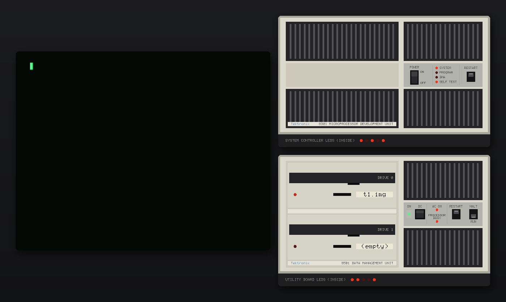
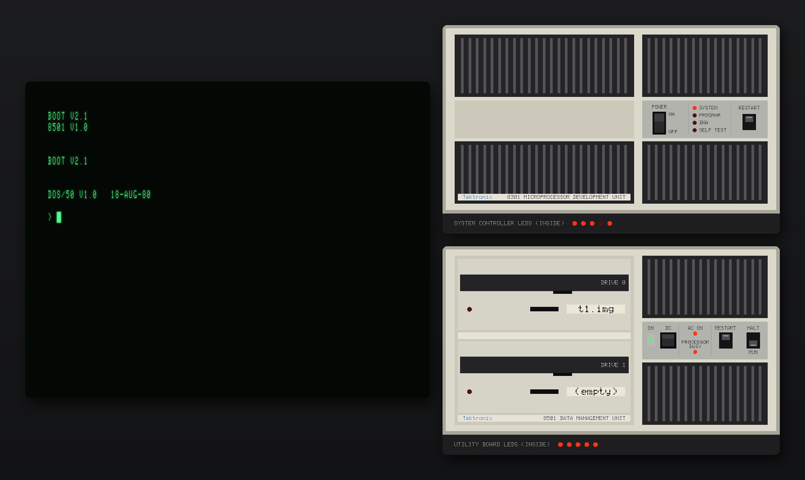
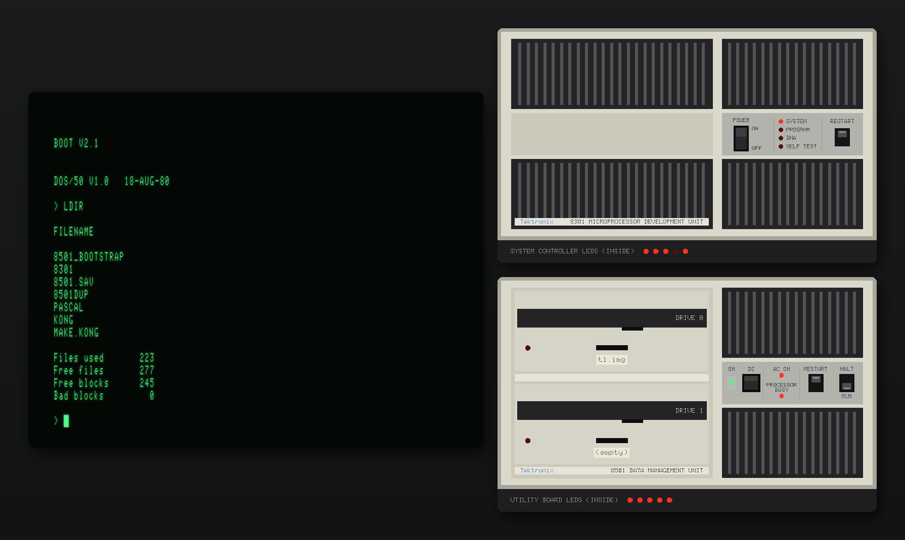
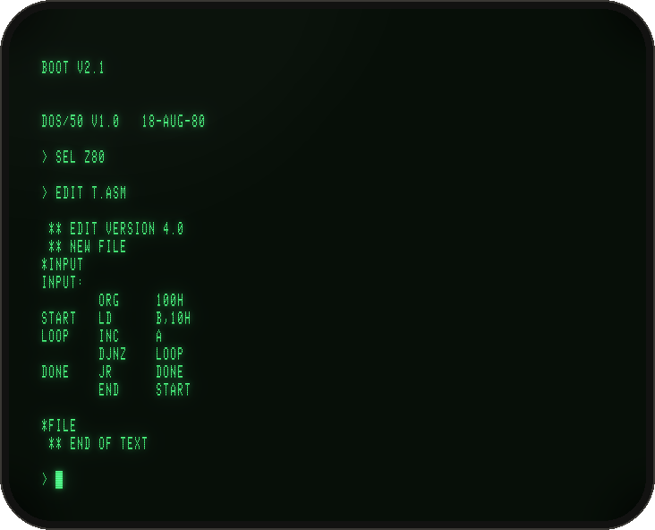
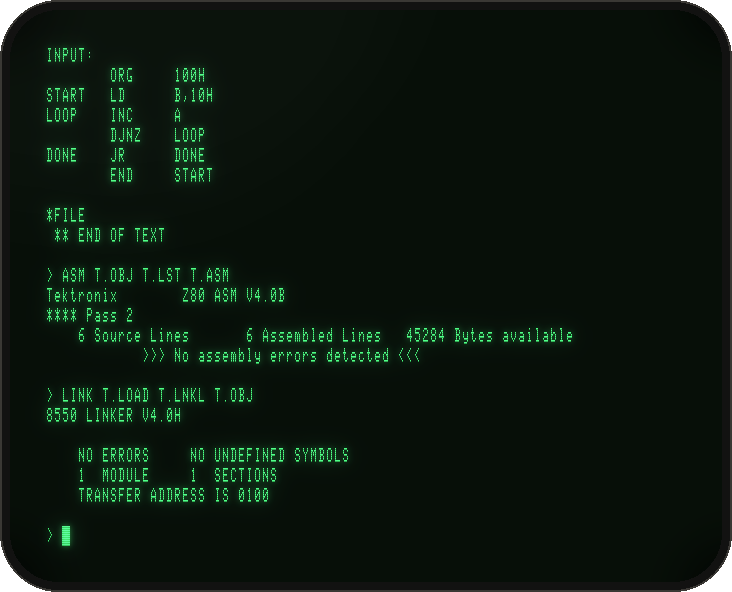
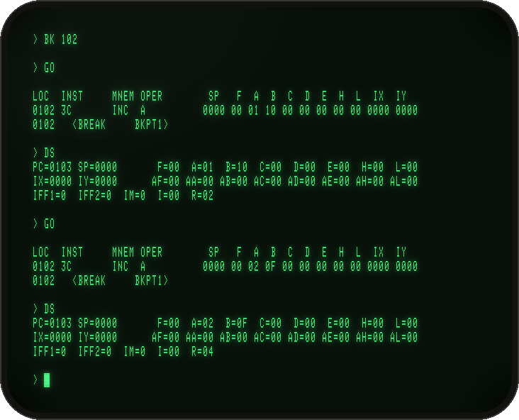
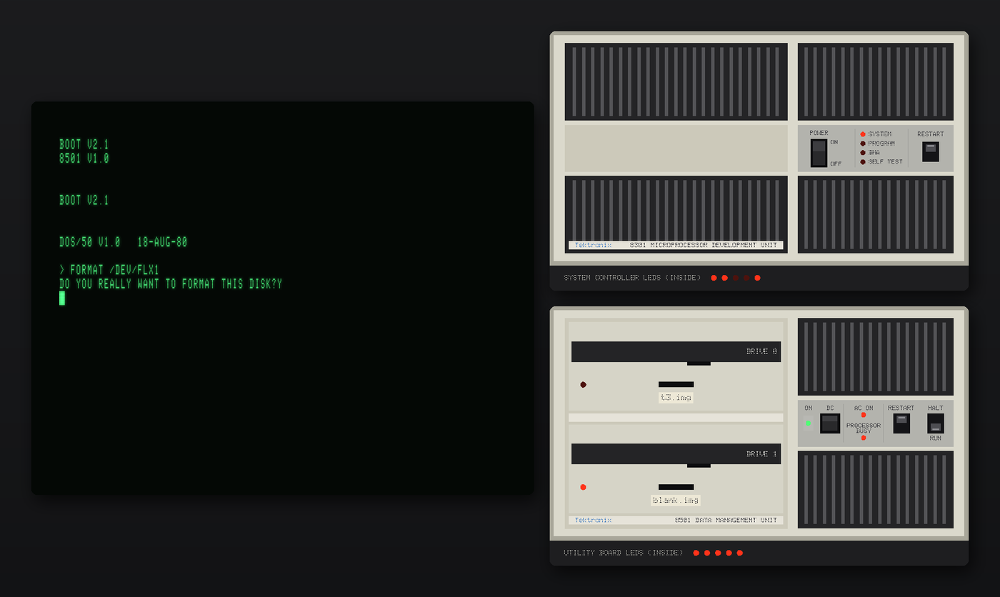
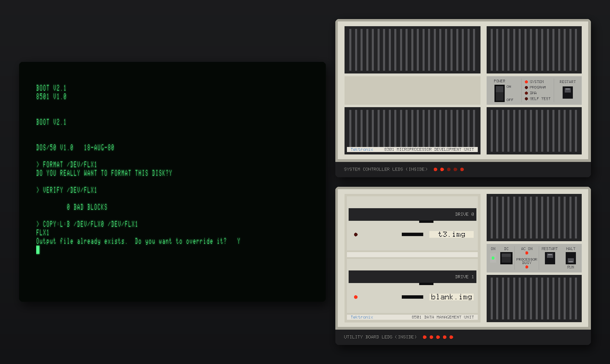

# Tutorials

Five short recipes. Each takes a few minutes. For the long tour (every DOS/50 tool, target systems, the host link, the RTPA, the PROM programmer, the diagnostics) see [OPERATION.md](OPERATION.md). Commands run from `emu/` unless noted.

1. [First boot in the graphical lab](#1-first-boot-in-the-graphical-lab)
2. [A Z80 program from scratch](#2-a-z80-program-from-scratch)
3. [Format a disc and duplicate the system disc](#3-format-a-disc-and-duplicate-the-system-disc)
4. [Scripted, headless runs](#4-scripted-headless-runs)
5. [Build for Windows](#5-build-for-windows)

---

## 1. First boot in the graphical lab

```
make gui
cp ../disks/System_Fixed.img ../disks/work.img
build/tek8550-gui -rw -0 ../disks/work.img
```
Three windows open, sized together to fit your screen: the **CT8500** on the left, the **8301** and **8501** front panels on the right.

What you are watching:
1. **0–8 s:** both units run their power-up diagnostics. The 8301's **SELF TEST** lamp is lit until they pass, and the LEDs inside each unit (on the strips under the panels) count through the tests.
2. **~3 s:** the 8501 boots from drive 0. Its red **drive lamp** flickers as the disc controller's own Z80 seeks and reads, at the real drive's speed.
3. **~27 s:** `DOS/50 V1.0 18-AUG-80` and the `>` prompt.


*3 seconds in: the screen is still blank while both units test themselves. The 8301's SELF TEST lamp is lit, the inside LEDs show test codes, and drive 0's lamp glows as the 8501 starts booting.*


*~29 s: DOS/50 is up. SELF TEST has gone out, and the 8501 shows ON, AC ON and PROCESSOR BUSY.*

Click into the terminal and type `LDIR` + Return, then `HELP`.


*`LDIR` lists the root of the system disc in drive 0.*

Things to try:

| Do | To |
|---|---|
| **Cmd-T** (Ctrl+Alt+T elsewhere) | toggle turbo: the machine runs flat out |
| **Cmd-S** | switch between the CRT look and sharp pixels |
| **Cmd-V** / **Cmd-C** | paste text (typed at the terminal's 9600 baud) / copy the screen as text |
| click **RESTART** on a panel | restart that unit |
| **Cmd-L** | fit the windows to the screen again |
| **Cmd-Q** | quit; with `-rw` the disc is written back |

DOS/50 commands are upper case. A Backspace past the start of a line makes DOS/50 drop the line and move to a fresh one, without reprinting the prompt. That is original behaviour, not a terminal fault.

## 2. A Z80 program from scratch

At the `>` prompt, choose the Z80 and write a program with the line editor (**Cmd-V** pastes the source in one go):
```
> SEL Z80
> EDIT T.ASM
*INPUT
        ORG     100H
START   LD      B,10H
LOOP    INC     A
        DJNZ    LOOP
DONE    JR      DONE
        END     START
                         (an empty line ends input)
*FILE
```

*EDIT's `INPUT` mode takes the lines; an empty line ends it, and `FILE` saves.*

Assemble, link and load it into the emulator board's memory. ASM and LINK take tens of seconds each, as they did on the real lab (**Cmd-T** speeds them up):
```
> ASM T.OBJ T.LST T.ASM
> LINK T.LOAD T.LNKL T.OBJ
> LOAD T.LOAD
```

*No assembly errors; the linker resolves everything and puts the transfer address at 0100.*

Debug it:
```
> BK 102                 breakpoint on LOOP
> GO
0102   <BREAK     BKPT1>
> DS                     registers: A=01, B=10
> GO                     next pass: A=02, B=0F
> CLBP
> GO                     runs to the end; Esc Esc stops it
```

*Each `GO` stops at the breakpoint on `LOOP`. `DS` shows A counting up and B (the DJNZ counter) counting down.*
Watch the 8301 panel while it runs: **PROGRAM** lights while the emulator processor runs your code, and **SYSTEM** lights while the 2650 has control.

ACE, the full-screen editor, the assembler's syntax quirks and the other debugging commands are in [OPERATION.md §3–5](OPERATION.md#3-write-a-program).

## 3. Format a disc and duplicate the system disc

The 8501's disc controller runs its original firmware, so a blank disc really has to be formatted. Make an empty image and insert it into drive 1 **after** DOS/50 is up. As on the real lab, an unformatted disc in a drive at power-up holds up the boot.

```
: > ../disks/blank.img
```
- **Graphical:** drop `blank.img` onto **DRIVE 1** on the 8501 panel. Clicking the drive later ejects it.
- **Headless:** add `-mount 30 1=../disks/blank.img` to the command line, or use the monitor (**Ctrl-]**, then `m 1 ../disks/blank.img`).

Then, following Tektronix's own procedure, type `FORMAT /DEV/FLX1`. FORMAT first probes the disc, which takes about 20 seconds on a blank one: the controller tries both densities and finds no data. Drive 1's lamp shows the work:


*Drive 1 holds `blank.img` and its lamp is lit while the controller looks for data on the blank disc.*

Then it asks for confirmation (the `Y` you type is not echoed):
```
> FORMAT /DEV/FLX1
DO YOU REALLY WANT TO FORMAT THIS DISK? Y        about 50 s: two revolutions per track, 154 tracks
```

*Formatting: the controller's Z80 writes every track from index to index, laying down the IBM System 34 format sector by sector.*

Check it, then copy the system disc onto it:
```
> VERIFY /DEV/FLX1
            0 BAD BLOCKS                          several minutes: block by block
> COPY:L:B /DEV/FLX0 /DEV/FLX1
Output file already exists.  Do you want to override it? Y
```

*COPY:L:B copies the whole device, block by block; drive 1's lamp stays lit while it writes.*


*Done: the blank disc is now a copy of the system disc.*
Run with `-rw`, and `blank.img` is now a copy of the system disc. Check it with the sibling tool: `../tekmato/tekmato -open ../disks/blank.img -check -list /`. `FORMAT:S` makes a single-density disc. The disc's sides follow the image: an empty file is a double-sided disc, and a single-sided image (1989 records) gives single-sided media.

## 4. Scripted, headless runs

Every run can be scripted, which is how the regression checks and the screenshots are made. `-cycles` sets the length in 2650 cycles (2,000,000 per second of machine time), and a batch run goes about 100× faster than real time:
```
build/tek8550 -term tty -0 ../disks/System_Fixed.img -cycles $((60*2000000)) \
    -type 32 'LDIR\r' -snap 40 ldir.scr -screen final.txt </dev/null
python3 ../tools/render_screens.py --crt ldir.scr ldir.png       # a CT8500-style PNG
```
| Option | Does |
|---|---|
| `-type T TEXT` | type at machine time T (`\r` Return, `\e` Esc, `\xHH`) |
| `-snap T FILE` / `-screen FILE` | save the screen at time T / at exit |
| `-mount T N=FILE`, `-eject T N` | change discs at time T |
| `-outputs FILE` | log every front-panel lamp change with its time |
| `-log`, `-hsilog`, `-dump` | terminal output, the 8301↔8501 link traffic, memory images |

The graphical front end takes the same options. Add `-shot T FILE.bmp` to save its windows, and run it with no display using `SDL_VIDEODRIVER=dummy SDL_RENDER_DRIVER=software`. `tools/make_hero.sh` makes the README picture that way, and `tools/make_tutorial_shots.sh` makes the pictures in these tutorials. Batch runs of the graphical front end advance a fixed 1/60 s of machine time per frame, so the pictures come out identical on every run. `tools/make_screenshots.sh` replays a whole edit → assemble → link → run session.

## 5. Build for Windows

**Natively, with [MSYS2](https://www.msys2.org/)**, in the *MINGW64* shell:
```
pacman -S make mingw-w64-x86_64-gcc mingw-w64-x86_64-SDL3 mingw-w64-x86_64-pkgconf
cd emu
make && make gui
```
**Cross-compiling from macOS or Linux** with mingw-w64 (`brew install mingw-w64`, `apt install g++-mingw-w64-x86-64`):
```
make CROSS=x86_64-w64-mingw32-                     # build-win/*.exe
make gui CROSS=x86_64-w64-mingw32- SDL3_DIR=/path/to/SDL3-3.x.y/x86_64-w64-mingw32
```
For the GUI, get `SDL3-devel-3.x.y-mingw.tar.gz` from [SDL's releases](https://github.com/libsdl-org/SDL/releases). The build copies `SDL3.dll` next to `tek8550-gui.exe`.

The executables are self-contained, apart from `SDL3.dll` for the GUI. They use only Windows 10+ system libraries. Like the macOS/Linux builds, they find the ROMs (`../roms/8550`) and panel artwork (`artwork/`) relative to the current directory, so run them from `emu\`:
```
cd emu
build-win\tek8550-gui.exe -0 ..\disks\work.img
```
`tek8550.exe` turns the Windows console (Windows Terminal or the classic console) into the CT8500, using its VT mode. The prototype and REMOTE links use Winsock: `tcp:` works everywhere, and `unix:` where the toolchain has `<afunix.h>`.
