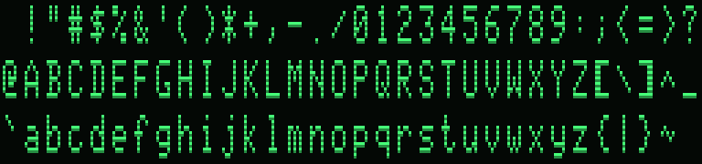
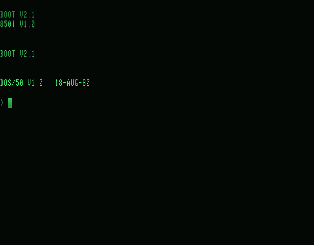
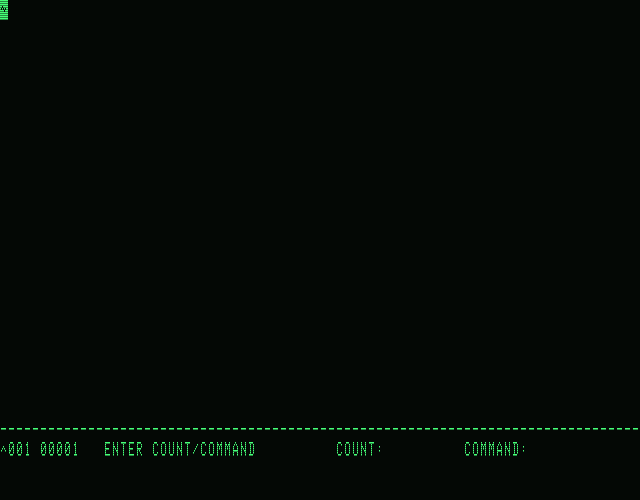
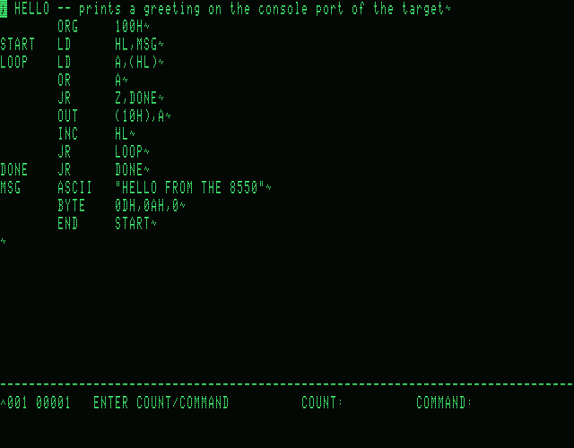
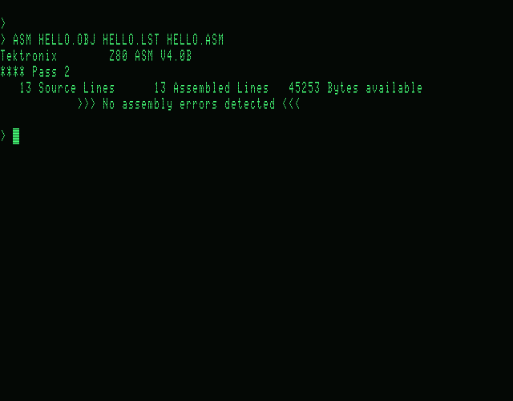
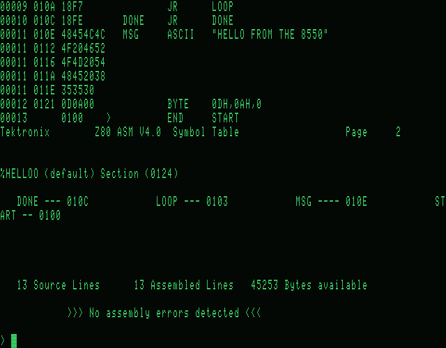
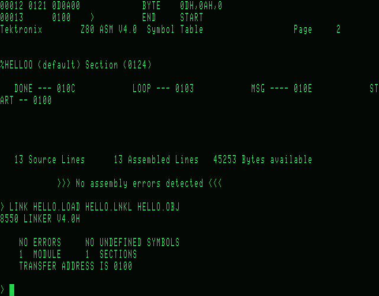
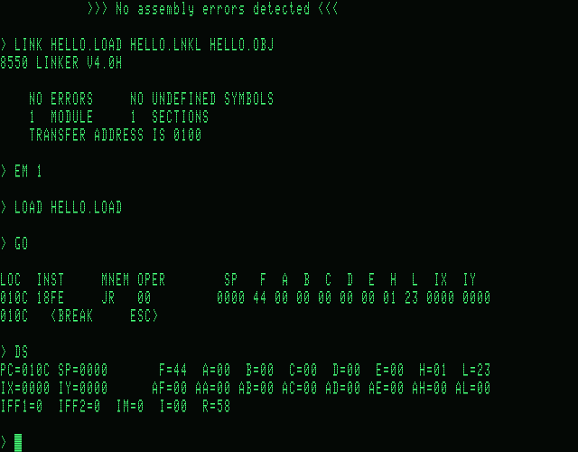
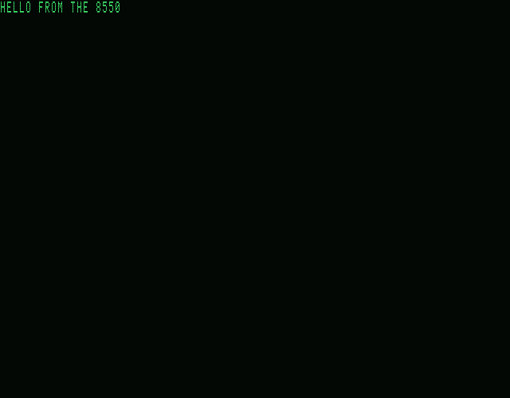

# 8550 session: edit, assemble, link, run (emulation mode 1, external target)

Captured from the emulated CT8500 and drawn on its documented raster: 80×25 characters on a 6×8 dot matrix in an
8×10 dot field, i.e. 640 dots × 250 scan lines, green on black (CT8500 Operators Manual 070-3737-00, "Display Features").
Each scan line is doubled (second line dimmer) to give 640×500 px, close to the 12-inch tube's aspect ratio.
The CT8500's own character ROM has never been dumped, so the glyphs are an approximation (`tools/ct8500_font.py`, sheet
below). Upper case, digits and punctuation come from a genuine Tektronix character generator of the same era, the
308 data analyzer's 160-0797-00 (TekWiki dump, CRC fd426d5f). Lower case was drawn to match, with descenders in the
matrix's 8th row (the CT8500 uses 6×8 versus the 4023/CT8100's 5×7).

 Regenerate with `tools/make_screenshots.sh`
(`tools/render_screens.py --style modern` gives the plain TrueType variant).

1.  Power-on: 8301 boot ROM, 8501 file server, **DOS/50 V1.0** prompt.
2.  `SEL Z80`, `ACE HELLO.ASM`: a new, empty file in the full-screen editor.
3.  After Insert Line (CT8500 key code ESC 0C) and typing the program; `EX` saves it.
4.  `ASM HELLO.OBJ HELLO.LST HELLO.ASM`: Tektronix Z80 ASM V4.0B, no errors.
5.  `COPY HELLO.LST CONO`: the listing with object code and symbol table.
6.  `LINK HELLO.LOAD HELLO.LNKL HELLO.OBJ`: transfer address 0100.
7.  `EM 1`, `LOAD`, `GO`: the program runs on the Z80 emulator processor; ESC ESC breaks it; `DS` shows the registers.
8.  Meanwhile, on the target system's own console (`tools/proto_target.py`, reached over IPC): the program's `OUT (10H),A` output.
